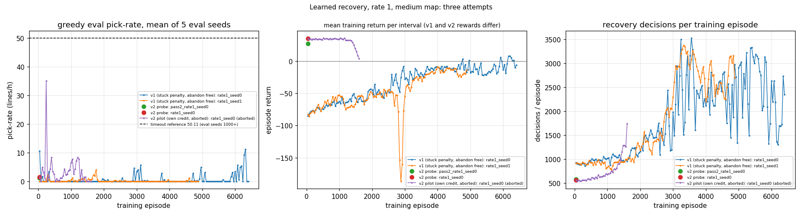
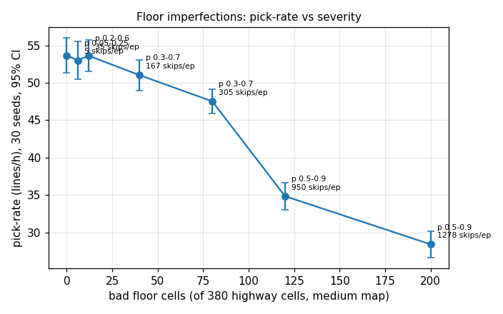
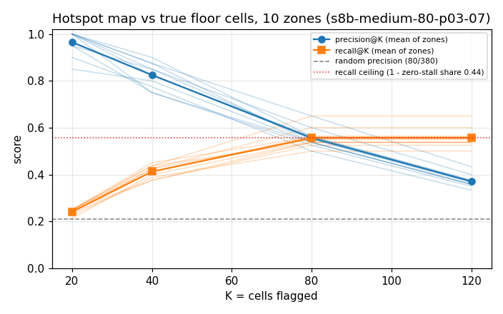
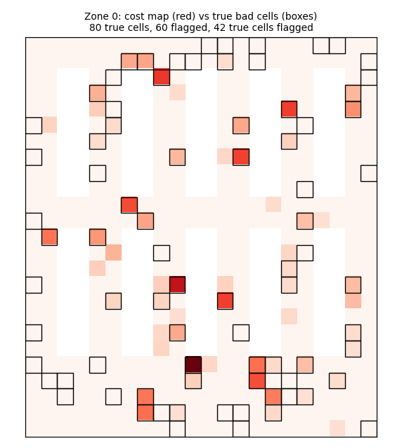
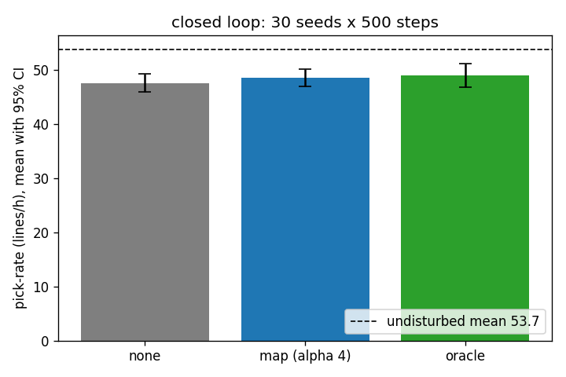

# warehouse-rl

Can a learned policy make a simulated robot warehouse recover from stuck robots better than a timeout or a hand-written rule? And, as the original question, does a learned task-allocation policy beat the Closest-Task-Assignment (CTA) heuristic on pick-rate?

Environment: [TA-RWARE](https://github.com/uoe-agents/task-assignment-robotic-warehouse) (Edinburgh, MIT).
Metric: pick-rate in order-lines per hour, same map, same seeds, against the CTA heuristic that ships with the env (nearest free AGV per request).

Plan, decision log, review findings and sprint plan: [docs/SCOPE.md](docs/SCOPE.md). Current direction (2026-10-10): Sprint 1 evaluation harness, Sprint 2 disturbance layer and density/failure sweeps with CTA only, Sprint 3 learned stuck-recovery vs timeout vs hand-written rule. Dispatcher learning is optional Sprint 4. Short summary page: https://claude.ai/artifact/33YWuNCVFjQxH3LdYXRbS3

Replay of one CTA episode: open `results/replay_small.html` in a browser (made by `scripts/record_episode.py` + `scripts/replay_template.html`).

## Setup (macOS)

Absolute simulator numbers in this README are macOS arm64 numbers; Linux gives different absolute values (A* tie-breaking) and the same paired comparisons. See [docs/PLATFORM.md](docs/PLATFORM.md).

```
./scripts/setup.sh
.venv/bin/python scripts/evaluate.py --policy cta --env tarware-medium-8agvs-4pickers-globalobs-v1 --seeds 0-9 --steps 500
```

`scripts/evaluate.py` is resumable and multiprocess (`--workers`, else `SCHED_WORKERS`, else cpu_count - 2) and writes `results/<policy>_<env>_<steps>.json`. `scripts/throughput.py` measures steps/s per worker and in total.

Hardware this was built on: M1 Pro, 10 cores, 16 GB, CPU only. The env steps at roughly 1,700 steps/s on the small map (500-step episode in 0.3 s), so all training here is local.

## Baselines (CTA heuristic, 10 seeds, 2026-10-09)

| Map | Agents | Pick-rate mean (lines/h) | SD | 95% CI |
| --- | --- | --- | --- | --- |
| medium, global obs | 8 AGV + 4 pickers | 54.4 | 6.9 | 49.5 to 59.4 |
| small, global obs | 4 AGV + 2 pickers | 30.5 | 2.9 | 28.4 to 32.6 |
| small, partial obs | 4 AGV + 2 pickers | 30.5 | 2.9 | 28.4 to 32.6 |

SD is the sample SD (ddof=1) and the CI is a Student-t 95% interval over the 10 seeds, both recomputed with `evaluate.summarise` from the rows in `results/fifo_tarware-medium-8agvs-4pickers-globalobs-v1.json`, `results/fifo_tarware-small-4agvs-2pickers-globalobs-v1.json` and `results/fifo_tarware-small-4agvs-2pickers-partialobs-v1.json`. The SD convention changed from the population SD used in the first version of this table (2.8 and 6.6).

Raw per-episode numbers are in `results/fifo_*.json`; these files predate the rename (the CTA heuristic was called FIFO in this repo before 2026-10-10). The heuristic does not read observations, so partial and global give identical results.

The medium map is the paper's "GTP Small" (Krnjaic et al. 2023), where the paper reports 52.7 lines/h for the same heuristic. At 500 steps one delivery is 1.44 lines/h and the 95% CI over 10 seeds is about +/- 5 lines/h on this map (+/- 2 on small, see the table), so these numbers cannot resolve a 5% effect; Sprint 1 fixes the evaluation length and seed count.

### Evaluation resolution

CTA on medium (8 AGV + 4 pickers, global obs), seeds 0-29, from `results/cta_tarware-medium-8agvs-4pickers-globalobs-v1_500.json`, `_2000.json` and `_5000.json`:

| Episode length | Mean (lines/h) | SD | 95% CI | MDE (abs) | MDE % of mean | Seeds for 5% | s/seed |
| --- | --- | --- | --- | --- | --- | --- | --- |
| 500 | 53.66 | 6.51 | +/- 2.43 | 4.71 | 8.8% | 93 | 1.82 |
| 2000 | 49.39 | 10.60 | +/- 3.96 | 7.67 | 15.5% | 290 | 7.14 |
| 5000 | 47.04 | 14.20 | +/- 5.30 | 10.27 | 21.8% | 572 | 17.75 |

SD is ddof=1 and the CI is Student-t (t = 2.045, 29 df). The minimum detectable effect (MDE) is for two policies at 30 seeds each, two-sided alpha 0.05, power 0.8, normal approximation: MDE = (z_0.975 + z_0.8) * SD * sqrt(2/n) = 2.80 * SD * sqrt(2/30). "Seeds for 5%" is the same formula solved for n per policy: n = 2 * (2.80 * SD / (0.05 * mean))^2. s/seed is the mean `wall_s` per row (one process).

**Decision:** no episode length makes a 5% effect detectable at 30 seeds; at 5000 steps it would take 572 seeds per policy. For the operator: 500 steps needs 93 seeds per policy for the same 5% (about 21 s of compute per policy on 8 workers, against about 21 min for 572 seeds at 5000).

Why SD grows with length: some episodes deadlock and never recover. Seed 4 delivers 33 at both 2000 and 5000 steps; seed 17 freezes at 35 deliveries with 1 stuck and 25 clashes at every length (the built-in recovery never fires); seed 16 collapses between 2000 and 5000. The distribution is bimodal, so the MDE at 2000 and 5000 is driven by about three seeds, not by spread among normal episodes.

**Warm-up for Sprint 2:** no discard (W = 0), and no long episodes. Episodes are deterministic per seed, so each longer run extends the shorter one (deliveries are non-decreasing across lengths for all 30 seeds). On the 25 seeds that do not collapse, the rates per window are 54.4 lines/h (steps 0-500), 51.8 (500-2000) and 53.1 (2000-5000). There is no start-up transient to discard; the falling per-length mean (53.7 to 49.4 to 47.0) comes from deadlocks piling up.

Throughput (`results/throughput.json`, medium, 8 worker processes, 10 episodes x 500 steps, 10 CPUs): 2185.7 steps/s in total, 274.3 steps/s per worker.

## Sprint 2: disturbances, stuck-aware CTA, sweeps

### Sprint 2 results (2026-10-10)

From `results/sweeps/density.json`, `breakdown.json`, `delay.json` and `router.json`: 30 seeds (0-29) per (point, policy), 500 steps, medium map. Mean, SD (ddof=1) and the Student-t 95% CI half-width are computed with `evaluate.summarise` over the 30 seeds; the paired delta is the same summary over the 30 per-seed differences (same seed, same disturbance schedule). Stuck-busy % = sum(`stuck_busy_agent_steps`) / (n_agents x steps) and frozen % = sum(`frozen_agent_steps`) / (n_agents x steps), pooled over the 30 seeds; n_agents counts AGVs and pickers. Abandoned / ep is the mean of `abandoned_tasks` (stuck-timeout drops) per episode. The 8-AGV, rate-0 cell (53.66) is the same number as the S1 500-step evaluation, as it should be.

**a. Density** (CTA, pickers = AGVs / 2):

| Point | Policy | Mean (lines/h) | SD | 95% CI | Stuck-busy % | Frozen % | Abandoned / ep |
| --- | --- | --- | --- | --- | --- | --- | --- |
| 2 | cta | 14.45 | 1.63 | +/- 0.61 | 7.9 | 0.0 | 0.00 |
| 4 | cta | 27.50 | 3.47 | +/- 1.30 | 8.9 | 0.0 | 0.43 |
| 6 | cta | 41.33 | 4.57 | +/- 1.71 | 10.0 | 0.0 | 1.27 |
| 8 | cta | 53.66 | 6.51 | +/- 2.43 | 10.7 | 0.0 | 2.87 |
| 10 | cta | 71.47 | 6.56 | +/- 2.45 | 12.6 | 0.0 | 2.97 |
| 12 | cta | 81.36 | 5.24 | +/- 1.96 | 12.4 | 0.0 | 4.33 |
| 14 | cta | 89.66 | 10.60 | +/- 3.96 | 13.1 | 0.0 | 5.90 |
| 16 | cta | 101.18 | 14.39 | +/- 5.37 | 14.3 | 0.0 | 15.10 |

Knee rule: the first AGV count whose mean pick-rate is not below the next grid point's with non-overlapping 95% CIs. There is no knee in 2-16: the mean rises at every step (the smallest step, 12 to 14 AGVs, is 81.36 to 89.66 with CIs that do not overlap), so it does not fall afterwards either. The return per AGV does shrink, from 7.2 lines/h per AGV at 2 AGVs to 6.3 at 16, and at 16 the SD and the abandonments jump (15.1 per episode against 5.9 at 14). That is the start of saturation, not a knee.

**b. Breakdown rate** (8 AGV + 4 pickers, freezes of 20 to 60 steps):

| Point | Policy | Mean (lines/h) | SD | 95% CI | Stuck-busy % | Frozen % | Abandoned / ep | Paired delta vs cta (95% CI) |
| --- | --- | --- | --- | --- | --- | --- | --- | --- |
| 0 | cta | 53.66 | 6.51 | +/- 2.43 | 10.7 | 0.0 | 2.87 | |
| 0 | stuck_aware_cta | 53.66 | 6.51 | +/- 2.43 | 10.7 | 0.0 | 2.87 | +0.00 (+0.00 to +0.00) |
| 1 | cta | 51.60 | 5.07 | +/- 1.89 | 11.2 | 3.4 | 4.30 | |
| 1 | stuck_aware_cta | 51.17 | 5.25 | +/- 1.96 | 11.1 | 3.4 | 4.10 | -0.43 (-0.78 to -0.08) |
| 2 | cta | 47.71 | 5.62 | +/- 2.10 | 10.5 | 6.2 | 3.37 | |
| 2 | stuck_aware_cta | 47.47 | 5.83 | +/- 2.18 | 10.6 | 6.2 | 3.37 | -0.24 (-0.49 to +0.01) |
| 4 | cta | 42.10 | 6.64 | +/- 2.48 | 10.6 | 12.8 | 5.93 | |
| 4 | stuck_aware_cta | 42.48 | 6.70 | +/- 2.50 | 10.7 | 12.8 | 5.83 | +0.38 (-0.20 to +0.97) |
| 8 | cta | 33.41 | 4.77 | +/- 1.78 | 10.3 | 22.1 | 6.80 | |
| 8 | stuck_aware_cta | 33.17 | 4.47 | +/- 1.67 | 10.2 | 22.1 | 6.70 | -0.24 (-0.71 to +0.23) |
| 16 | cta | 22.56 | 4.46 | +/- 1.67 | 10.6 | 37.7 | 9.90 | |
| 16 | stuck_aware_cta | 21.89 | 4.17 | +/- 1.56 | 10.5 | 37.7 | 9.90 | -0.67 (-1.55 to +0.21) |

**c. Delay** (8 AGV + 4 pickers; the delayed fraction of robot-time is 5.1%, 10.1%, 20.0% and 29.8% at p_skip 0.05, 0.1, 0.2 and 0.3):

| Point | Policy | Mean (lines/h) | SD | 95% CI | Stuck-busy % | Frozen % | Abandoned / ep | Paired delta vs cta (95% CI) |
| --- | --- | --- | --- | --- | --- | --- | --- | --- |
| 0 | cta | 53.66 | 6.51 | +/- 2.43 | 10.7 | 0.0 | 2.87 | |
| 0 | stuck_aware_cta | 53.66 | 6.51 | +/- 2.43 | 10.7 | 0.0 | 2.87 | +0.00 (+0.00 to +0.00) |
| 0.05 | cta | 52.51 | 5.14 | +/- 1.92 | 10.6 | 0.0 | 1.30 | |
| 0.05 | stuck_aware_cta | 52.51 | 5.14 | +/- 1.92 | 10.6 | 0.0 | 1.30 | +0.00 (+0.00 to +0.00) |
| 0.1 | cta | 48.19 | 5.72 | +/- 2.14 | 10.4 | 0.0 | 2.53 | |
| 0.1 | stuck_aware_cta | 48.62 | 5.24 | +/- 1.95 | 10.1 | 0.0 | 1.43 | +0.43 (-0.45 to +1.32) |
| 0.2 | cta | 44.06 | 4.52 | +/- 1.69 | 10.6 | 0.0 | 1.30 | |
| 0.2 | stuck_aware_cta | 44.06 | 4.52 | +/- 1.69 | 10.6 | 0.0 | 1.30 | +0.00 (+0.00 to +0.00) |
| 0.3 | cta | 38.88 | 3.86 | +/- 1.44 | 10.4 | 0.0 | 1.93 | |
| 0.3 | stuck_aware_cta | 38.88 | 3.86 | +/- 1.44 | 10.4 | 0.0 | 1.67 | +0.00 (+0.00 to +0.00) |

**d. Router ablation** (`cta_care` = CTA with `assign_care_for_agents` on):

| Point | Policy | Mean (lines/h) | SD | 95% CI | Stuck-busy % | Frozen % | Abandoned / ep | Paired delta vs cta (95% CI) |
| --- | --- | --- | --- | --- | --- | --- | --- | --- |
| 2 | cta | 14.45 | 1.63 | +/- 0.61 | 7.9 | 0.0 | 0.00 | |
| 2 | cta_care | 14.40 | 1.77 | +/- 0.66 | 7.9 | 0.0 | 0.03 | -0.05 (-0.22 to +0.12) |
| 4 | cta | 27.50 | 3.47 | +/- 1.30 | 8.9 | 0.0 | 0.43 | |
| 4 | cta_care | 27.74 | 3.09 | +/- 1.16 | 8.1 | 0.0 | 0.33 | +0.24 (-0.48 to +0.96) |
| 6 | cta | 41.33 | 4.57 | +/- 1.71 | 10.0 | 0.0 | 1.27 | |
| 6 | cta_care | 40.46 | 5.42 | +/- 2.02 | 9.1 | 0.0 | 0.93 | -0.86 (-2.42 to +0.69) |
| 8 | cta | 53.66 | 6.51 | +/- 2.43 | 10.7 | 0.0 | 2.87 | |
| 8 | cta_care | 53.52 | 6.82 | +/- 2.55 | 10.1 | 0.0 | 4.17 | -0.14 (-2.24 to +1.95) |
| 10 | cta | 71.47 | 6.56 | +/- 2.45 | 12.6 | 0.0 | 2.97 | |
| 10 | cta_care | 71.23 | 4.52 | +/- 1.69 | 11.5 | 0.0 | 2.73 | -0.24 (-2.22 to +1.74) |
| 12 | cta | 81.36 | 5.24 | +/- 1.96 | 12.4 | 0.0 | 4.33 | |
| 12 | cta_care | 79.87 | 6.45 | +/- 2.41 | 11.5 | 0.0 | 5.57 | -1.49 (-4.50 to +1.53) |
| 14 | cta | 89.66 | 10.60 | +/- 3.96 | 13.1 | 0.0 | 5.90 | |
| 14 | cta_care | 89.52 | 11.85 | +/- 4.42 | 11.9 | 0.0 | 7.63 | -0.14 (-4.13 to +3.84) |
| 16 | cta | 101.18 | 14.39 | +/- 5.37 | 14.3 | 0.0 | 15.10 | |
| 16 | cta_care | 99.65 | 14.22 | +/- 5.31 | 12.0 | 0.0 | 8.87 | -1.54 (-5.78 to +2.71) |

`cta_care` does not differ from CTA at any density: every paired CI contains 0. It lowers the stuck-busy fraction a little at every density from 4 AGVs up (14.3% to 12.0% at 16) without moving the pick-rate.

**Stuck-busy crossing 10% and what stuck-aware CTA recovers.**
- Stuck-busy is at or above 10% at every breakdown rate and every delay probability, **including rate 0**: 10.7% undisturbed, and 10.2% to 11.2% across both grids. The per-seed 95% CI contains 10% at every point except breakdown rate 1 (10.5% to 12.0%), so the threshold is reached by baseline congestion, not by the disturbances. It does not rise with the rate: a frozen robot's stuck counter is suppressed, so a breakdown shows up as frozen time (3.4% to 37.7%), not stuck time. What does rise with the breakdown rate is the stuck-timeout abandonments, 2.87 per episode at rate 0 to 9.90 at rate 16. Lowest rate above 10%: rate 0 for breakdown and for delay on the point estimate. That is at the threshold rather than clearly above it; only breakdown rate 1 is distinguishably above.
- Share of the CTA pick-rate loss against rate 0 that stuck-aware CTA recovers (paired delta / loss). Breakdown: -21% at rate 1 (loss 2.06, delta -0.43, CI -0.78 to -0.08: significantly worse, one of five tests), -4% at 2, +3% at 4, -1% at 8 and -2% at 16; the other four CIs contain 0. Delay: not applicable by construction. The frozen filter only acts on frozen robots and delay never freezes one, so the pick-rate is identical to CTA on every seed at p_skip 0.05, 0.2 and 0.3; at 0.1 it differs only through the abandonment path (+0.43, CI -0.45 to +1.32).

**Decision.**
- (a) The 10% stuck regime exists at every plausible rate. For breakdown that is 1 to 2 per robot-hour, which freezes 3.4% to 6.2% of robot-time; rates 8 and 16 freeze 22% and 38% of the fleet, which is not a fleet that is operating. For delay it is any p_skip, because stuck-busy is flat in it. The Exit rule's "recovery is moot" branch does not trigger and Sprint 3 recovery stands. The stuck time is present without any disturbance and does not grow with the rate, so the premise that *disturbances* produce the stuck regime is not supported. Most of it is a floor whose source is unverified (see below); that fork is flagged to the operator.
- (b) The frozen filter alone recovers none of the disturbance loss: between -21% and +3% of the breakdown loss, with every paired CI containing 0 except a small loss at rate 1.

**What "robots get stuck" means in this sim.** A robot is counted stuck-busy on a step when its `StuckCounter` is above 0. That means it has a mission, its requested action is not a turn and not a load toggle away from a goal, and it did not change cell. So NOOP waits and loading at a goal count, not only blocked moves (`resolve_stuck_agents` in `vendor/tarware/tarware/warehouse.py`). On the medium map with 8 AGVs and 4 pickers that is 10.7% of robot-time with no disturbance at all, and it grows with fleet size, from 7.9% at 2 AGVs to 14.3% at 16. Failure does not drive it, because it is flat across every breakdown and delay rate. Congestion is not the main part either. There is a 7.9% floor with only 3 robots on the map, and density adds 6.4 points from 2 to 16 AGVs (2.8 points at 8). The floor most likely includes structural waits such as AGV-picker handoffs and unloading, but these rows cannot split it by agent type or action, so its source is UNVERIFIED. The stuck time is mostly short waits: the env replans after 5 stuck steps and drops the mission at the timeout, and that happens only 2.87 times per 500-step episode at 8 AGVs. Injected breakdowns do not add stuck time; they take capacity away. A broken-down robot is frozen, not stuck, and the pick-rate falls almost linearly with the frozen fraction (53.66 to 22.56 lines/h as frozen time goes from 0% to 37.7%). Delays also cost capacity rather than stuck time: stuck-busy stays at 10.4% to 10.6% while the pick-rate falls to 38.88 at p_skip 0.3. Routing around other robots (`cta_care`) and never dispatching to a frozen robot (stuck-aware CTA) both leave the pick-rate where it was. Whatever recovery can win has to come from the busy robot that is waiting or blocked (replan, back off, return the shelf), not from the dispatch. Waits that are handoffs are out of recovery's reach, so the recoverable part of the 10.7% is smaller than 10.7%, by an amount these rows do not measure.

### Disturbance taxonomy (`src/warehouse_rl/disturb.py`)

`DisturbedWarehouse` subclasses the vendor env; `{}` means no disturbance. All schedules are drawn at reset from the (seed, config) pair only, so they are identical across policies (common random numbers). One step is 5 s; rates are onsets per robot-hour (per map for the map-level types).

- **breakdown**: the robot is frozen for a uniform number of steps (all its micro-actions become no-ops). "Stuck" is modelled as a freeze: a symptom, not a cause.
- **delay**: the robot skips a step with probability `p_skip` (execution delay). A delayed robot is not frozen.
- **blocked cell**: a highway cell becomes impassable for a while; planning avoids it and moves into it are cancelled.
- **burst**: extra requests enter the queue for a window of steps.
- **outage**: a goal station becomes impassable and AGVs cannot be sent there.

### Baselines

- **CTA** (`CtaPolicy`): the vendor heuristic, ported step by step. Unchanged by this sprint.
- **Stuck-aware CTA** (`StuckAwareCtaPolicy`): CTA with two changes. (1) A NEW AGV assignment never goes to an AGV that the layer has frozen for the step about to execute (current step only, no look-ahead) or to an AGV that abandoned its mission in the same call. (2) When the env's stuck timeout drops a PICKING mission (robot not carrying, not at the pick location), the item is released in that call and goes to the closest eligible AGV; if none is eligible it stays queued and unassigned until the next call. Idle AGVs are never excluded by their stuck counter.
- **Fence**: pickers keep CTA's static zones, and an AGV that freezes mid-mission keeps its order, because `act()` cannot cancel a busy path stored in the env. Cancelling is the recovery layer's job (Sprint 3). A mission whose path was empty when the env accepted it never becomes busy and is outside the abandonment rule (existing CTA behaviour).

### Sweeps (`scripts/sweep.py`)

All sweeps: 30 seeds (0-29), 500 steps, warm-up W = 0 (no discard), seed-paired under common random numbers, run on the disturbance layer so every row carries the frozen, stuck, abandoned and clash sums.

| Axis | Setting | Grid | Policies |
| --- | --- | --- | --- |
| a. density | medium map, AGVs (pickers = AGVs / 2) | 2, 4, 6, 8, 10, 12, 14, 16 | cta |
| b. breakdown rate | medium, 8 AGV + 4 pickers, AGV breakdowns, duration 20 to 60 steps | 0, 1, 2, 4, 8, 16 onsets per robot-hour | cta, stuck_aware_cta |
| c. delay | medium, 8 AGV + 4 pickers | p_skip 0, 0.05, 0.1, 0.2, 0.3 | cta, stuck_aware_cta |
| d. router ablation | density grid of (a) | as (a) | cta, cta_care |

The router-side toggle in (d) is `assign_care_for_agents` (`DisturbedWarehouse` and `WarehouseEnv`, default False): when True, the path the env computes on accepting a macro action treats other agents as obstacles. The policy's own distance estimate is not changed. `cta_care` is CTA with the toggle on.

Command (smoke test: add `--smoke`, which runs seeds 0-1 and the two endpoints of each grid; `--only a,b,c,d` selects sweeps):

```sh
.venv/bin/python scripts/sweep.py --workers N
```

Output: `results/sweeps/<sweep>.json` (`<sweep>_smoke.json` for smoke), written after every row, one row per (point, policy, seed), skipped on re-run; and `results/sweep_<sweep>.png` (PNGs are not committed). Plots show the mean per policy with a Student-t 95% CI band; the breakdown and delay plots add the seed-paired difference stuck_aware_cta - cta and the frozen and stuck fractions of robot-time.

`scripts/evaluate.py --policy stuck_aware_cta ... --disturb PRESET|JSON` runs the same policy on a single configuration and prints the seed-paired delta against the CTA file with the same disturbance tag.

### Disturbed replay

`results/replay_disturbed.json` is one episode on the small map (seed 0, preset `breakdown-heavy`, `stuck_aware_cta`), recorded with `scripts/record_episode.py --disturb breakdown-heavy --policy stuck_aware_cta --out results/replay_disturbed.json`. Frames carry a per-agent `fz` flag (frozen); `scripts/replay_template.html` ignores it.

## Sprint 3: recovery baselines

### Sprint 3 results: recovery baselines (2026-10-10)

Data: `results/recovery/timeout.json`, `tuned_timeout.json`, `rule.json` and `call_human.json`, written by `scripts/recovery_sweep.py`. The rate-0 reference is `stuck_aware_cta` at point 0 in `results/sweeps/breakdown.json`. Every row has 30 seeds (0-29) per (rate, policy). Runs are 500 steps on the medium map with 8 AGVs and 4 pickers. The dispatcher is `StuckAwareCtaPolicy` throughout. Breakdowns hit AGVs only and freeze them for 20 to 60 steps, with the same schedule as Sprint 2. Statistics are computed as in Sprint 2:
- Mean, SD and Student-t 95% CI come from `evaluate.summarise`.
- The paired delta is against `timeout` on the same seed and the same disturbance schedule.
- Fractions of robot-time are pooled over 12 robots x 500 steps x 30 seeds.
- Abandoned / ep is the mean of `abandoned_tasks`.

`timeout` reproduces the Sprint 2 `stuck_aware_cta` breakdown rows seed for seed (same pick_rate on all 120 episodes), and `tuned replan 5 abandon 15` reproduces `timeout`, so the deltas below are against the env default.

**a. TimeoutRecovery (env default: replan after 5 stuck steps, abandon after 15):**

| Rate | Policy | Mean (lines/h) | SD | 95% CI | Paired delta vs timeout (95% CI) | Stuck-busy % | Frozen % | Abandoned / ep |
| --- | --- | --- | --- | --- | --- | --- | --- | --- |
| 1 | timeout | 51.17 | 5.25 | +/- 1.96 |  | 11.1 | 3.4 | 4.10 |
| 2 | timeout | 47.47 | 5.83 | +/- 2.18 |  | 10.6 | 6.2 | 3.37 |
| 4 | timeout | 42.48 | 6.70 | +/- 2.50 |  | 10.7 | 12.8 | 5.83 |
| 8 | timeout | 33.17 | 4.47 | +/- 1.67 |  | 10.2 | 22.1 | 6.70 |

**b. TunedTimeoutRecovery** (replan x abandon thresholds):

| Rate | Policy | Mean (lines/h) | SD | 95% CI | Paired delta vs timeout (95% CI) | Stuck-busy % | Frozen % | Abandoned / ep |
| --- | --- | --- | --- | --- | --- | --- | --- | --- |
| 1 | tuned replan 3 abandon 10 | 50.88 | 4.77 | +/- 1.78 | -0.29 (-1.63 to +1.05) | 10.8 | 3.4 | 5.70 |
| 1 | tuned replan 3 abandon 15 | 51.41 | 4.95 | +/- 1.85 | +0.24 (-1.37 to +1.85) | 10.9 | 3.4 | 3.50 |
| 1 | tuned replan 3 abandon 25 | 50.26 | 6.01 | +/- 2.24 | -0.91 (-2.98 to +1.16) | 11.3 | 3.4 | 1.40 |
| 1 | tuned replan 5 abandon 10 | 50.74 | 5.61 | +/- 2.09 | -0.43 (-1.89 to +1.02) | 10.8 | 3.4 | 5.20 |
| 1 | tuned replan 5 abandon 15 | 51.17 | 5.25 | +/- 1.96 | +0.00 (+0.00 to +0.00) | 11.1 | 3.4 | 4.10 |
| 1 | tuned replan 5 abandon 25 | 49.97 | 5.02 | +/- 1.87 | -1.20 (-2.61 to +0.21) | 11.1 | 3.4 | 1.53 |
| 1 | tuned replan 8 abandon 10 | 50.83 | 5.71 | +/- 2.13 | -0.34 (-2.20 to +1.52) | 11.1 | 3.4 | 6.10 |
| 1 | tuned replan 8 abandon 15 | 50.78 | 4.60 | +/- 1.72 | -0.38 (-1.53 to +0.76) | 11.0 | 3.4 | 3.13 |
| 1 | tuned replan 8 abandon 25 | 50.30 | 4.52 | +/- 1.69 | -0.86 (-2.23 to +0.50) | 11.2 | 3.4 | 1.57 |
| 2 | tuned replan 3 abandon 10 | 48.29 | 5.66 | +/- 2.11 | +0.82 (-0.22 to +1.85) | 10.7 | 6.2 | 5.73 |
| 2 | tuned replan 3 abandon 15 | 47.95 | 6.30 | +/- 2.35 | +0.48 (-1.16 to +2.12) | 11.0 | 6.2 | 3.63 |
| 2 | tuned replan 3 abandon 25 | 47.76 | 6.95 | +/- 2.60 | +0.29 (-1.46 to +2.03) | 11.9 | 6.2 | 1.83 |
| 2 | tuned replan 5 abandon 10 | 48.05 | 6.47 | +/- 2.41 | +0.58 (-0.42 to +1.57) | 10.0 | 6.2 | 5.33 |
| 2 | tuned replan 5 abandon 15 | 47.47 | 5.83 | +/- 2.18 | +0.00 (+0.00 to +0.00) | 10.6 | 6.2 | 3.37 |
| 2 | tuned replan 5 abandon 25 | 47.81 | 6.21 | +/- 2.32 | +0.34 (-0.60 to +1.27) | 11.2 | 6.2 | 1.77 |
| 2 | tuned replan 8 abandon 10 | 48.29 | 6.32 | +/- 2.36 | +0.82 (-0.15 to +1.78) | 10.2 | 6.2 | 6.77 |
| 2 | tuned replan 8 abandon 15 | 47.76 | 5.99 | +/- 2.24 | +0.29 (-0.41 to +0.99) | 10.4 | 6.2 | 3.33 |
| 2 | tuned replan 8 abandon 25 | 48.10 | 5.87 | +/- 2.19 | +0.62 (-0.36 to +1.61) | 11.2 | 6.2 | 1.67 |
| 4 | tuned replan 3 abandon 10 | 41.04 | 5.07 | +/- 1.89 | -1.44 (-2.69 to -0.19) | 10.0 | 12.8 | 8.03 |
| 4 | tuned replan 3 abandon 15 | 41.42 | 5.92 | +/- 2.21 | -1.06 (-2.21 to +0.10) | 10.5 | 12.8 | 5.57 |
| 4 | tuned replan 3 abandon 25 | 40.61 | 5.46 | +/- 2.04 | -1.87 (-3.16 to -0.58) | 11.3 | 12.8 | 3.20 |
| 4 | tuned replan 5 abandon 10 | 42.00 | 6.25 | +/- 2.33 | -0.48 (-0.98 to +0.02) | 10.2 | 12.8 | 8.60 |
| 4 | tuned replan 5 abandon 15 | 42.48 | 6.70 | +/- 2.50 | +0.00 (+0.00 to +0.00) | 10.7 | 12.8 | 5.83 |
| 4 | tuned replan 5 abandon 25 | 42.43 | 6.31 | +/- 2.36 | -0.05 (-1.68 to +1.58) | 11.3 | 12.8 | 3.17 |
| 4 | tuned replan 8 abandon 10 | 41.42 | 6.46 | +/- 2.41 | -1.06 (-1.99 to -0.12) | 10.2 | 12.8 | 8.87 |
| 4 | tuned replan 8 abandon 15 | 41.47 | 6.22 | +/- 2.32 | -1.01 (-1.77 to -0.25) | 10.7 | 12.8 | 6.30 |
| 4 | tuned replan 8 abandon 25 | 42.19 | 5.69 | +/- 2.12 | -0.29 (-1.49 to +0.91) | 11.4 | 12.8 | 3.50 |
| 8 | tuned replan 3 abandon 10 | 33.89 | 4.42 | +/- 1.65 | +0.72 (-0.05 to +1.49) | 9.7 | 22.1 | 9.57 |
| 8 | tuned replan 3 abandon 15 | 34.03 | 4.73 | +/- 1.77 | +0.86 (+0.19 to +1.54) | 10.3 | 22.1 | 7.20 |
| 8 | tuned replan 3 abandon 25 | 33.70 | 4.73 | +/- 1.77 | +0.53 (-0.35 to +1.40) | 11.0 | 22.1 | 4.70 |
| 8 | tuned replan 5 abandon 10 | 33.65 | 4.48 | +/- 1.67 | +0.48 (-0.16 to +1.12) | 9.8 | 22.1 | 9.47 |
| 8 | tuned replan 5 abandon 15 | 33.17 | 4.47 | +/- 1.67 | +0.00 (+0.00 to +0.00) | 10.2 | 22.1 | 6.70 |
| 8 | tuned replan 5 abandon 25 | 32.88 | 4.69 | +/- 1.75 | -0.29 (-1.13 to +0.55) | 10.6 | 22.1 | 4.90 |
| 8 | tuned replan 8 abandon 10 | 33.74 | 4.53 | +/- 1.69 | +0.58 (-0.32 to +1.48) | 9.8 | 22.1 | 10.60 |
| 8 | tuned replan 8 abandon 15 | 33.22 | 4.52 | +/- 1.69 | +0.05 (-0.54 to +0.64) | 9.8 | 22.1 | 7.10 |
| 8 | tuned replan 8 abandon 25 | 33.26 | 4.77 | +/- 1.78 | +0.10 (-0.71 to +0.91) | 10.6 | 22.1 | 4.47 |

**c. RuleRecovery** (back off after B, reroute after R, abandon after A, no human):

| Rate | Policy | Mean (lines/h) | SD | 95% CI | Paired delta vs timeout (95% CI) | Stuck-busy % | Frozen % | Abandoned / ep |
| --- | --- | --- | --- | --- | --- | --- | --- | --- |
| 1 | rule 2/5/10 | 45.74 | 6.64 | +/- 2.48 | -5.42 (-7.52 to -3.33) | 11.9 | 3.4 | 6.50 |
| 1 | rule 3/6/15 | 47.28 | 6.50 | +/- 2.43 | -3.89 (-6.01 to -1.76) | 12.3 | 3.4 | 7.70 |
| 1 | rule 5/10/25 | 50.40 | 5.27 | +/- 1.97 | -0.77 (-2.20 to +0.66) | 12.2 | 3.4 | 2.10 |
| 2 | rule 2/5/10 | 44.40 | 5.48 | +/- 2.05 | -3.07 (-5.02 to -1.13) | 12.1 | 6.2 | 8.77 |
| 2 | rule 3/6/15 | 45.12 | 5.01 | +/- 1.87 | -2.35 (-4.29 to -0.42) | 11.4 | 6.2 | 5.20 |
| 2 | rule 5/10/25 | 46.66 | 4.81 | +/- 1.79 | -0.82 (-2.18 to +0.54) | 11.6 | 6.2 | 2.40 |
| 4 | rule 2/5/10 | 38.78 | 5.70 | +/- 2.13 | -3.70 (-5.24 to -2.15) | 11.6 | 12.8 | 9.47 |
| 4 | rule 3/6/15 | 39.60 | 6.72 | +/- 2.51 | -2.88 (-4.55 to -1.21) | 11.5 | 12.8 | 7.83 |
| 4 | rule 5/10/25 | 39.46 | 5.64 | +/- 2.11 | -3.02 (-5.17 to -0.88) | 11.7 | 12.8 | 3.83 |
| 8 | rule 2/5/10 | 32.26 | 5.91 | +/- 2.21 | -0.91 (-2.44 to +0.61) | 10.8 | 22.1 | 10.30 |
| 8 | rule 3/6/15 | 31.97 | 5.31 | +/- 1.98 | -1.20 (-2.50 to +0.10) | 10.7 | 22.1 | 9.07 |
| 8 | rule 5/10/25 | 32.78 | 4.61 | +/- 1.72 | -0.38 (-1.59 to +0.82) | 11.0 | 22.1 | 5.23 |

**Best per rate, by paired delta in pick_rate.** These CIs are optimistic: each is the winner picked from 8 non-default tuned points or 3 rules, and the CI does not correct for that selection.
- Best tuned timeout:
  - Rate 1: replan 3 abandon 15, +0.24 (-1.37 to +1.85).
  - Rate 2: replan 8 abandon 10, +0.82 (-0.15 to +1.78). It ties with replan 3 abandon 10, +0.82 (-0.22 to +1.85); the tie is broken by the higher CI low end.
  - Rate 4: the default 5/15 is best. Every other point is below it, and four of them significantly.
  - Rate 8: replan 3 abandon 15, +0.86 (+0.19 to +1.54).
  - No single point wins at every rate. Only 1 of the 32 non-default comparisons excludes 0 in the favourable direction, which is about what chance gives at 95%.
- Best rule:
  - Rates 1, 2 and 8: 5/10/25, at -0.77 (-2.20 to +0.66), -0.82 (-2.18 to +0.54) and -0.38 (-1.59 to +0.82).
  - Rate 4: 3/6/15, at -2.88 (-4.55 to -1.21).
  - No rule beats `timeout` at any rate. The faster rules (2/5/10, 3/6/15) are significantly worse at rates 1, 2 and 4.
  - The rules log 26 to 67 recovery fallbacks per episode (`recovery_fallbacks`) and abandon more often than the default, except 5/10/25. Call-human % is 0 by construction in tables a to c (no human rung); it is reported in (d).

**d. Call-human curve** (rule 3/6/15 with call-human after 14 stuck steps; 3/6/15 was the default `--best-rule` and is not the best rule found in (c)):

| Rate | Cost (steps per call) | Mean (lines/h) | Delta vs no-human rule (95% CI) | Delta vs timeout (95% CI) | Calls decided / ep | Calls executed / ep | Human-steps / ep (total cost) | Call-human % (accounting) | Extra deliveries / ep vs no-human | Human-steps per extra delivery | Abandoned / ep |
| --- | --- | --- | --- | --- | --- | --- | --- | --- | --- | --- | --- |
| 1 | 0 | 49.06 | +1.78 (+0.04 to +3.51) | -2.11 (-3.56 to -0.67) | 5.00 | n/a (cost 0) | 0.0 | 0.00 | +1.23 | 0 | 2.50 |
| 1 | 5 | 49.06 | +1.78 (+0.04 to +3.51) | -2.11 (-3.56 to -0.67) | 5.00 | 2.27 | 11.3 | 0.19 | +1.23 | 9 | 2.50 |
| 1 | 15 | 49.06 | +1.78 (+0.04 to +3.51) | -2.11 (-3.56 to -0.67) | 5.00 | 2.27 | 34.0 | 0.57 | +1.23 | 28 | 2.50 |
| 1 | 30 | 49.06 | +1.78 (+0.04 to +3.51) | -2.11 (-3.56 to -0.67) | 5.00 | 2.27 | 68.0 | 1.13 | +1.23 | 55 | 2.50 |
| 1 | 60 | 49.06 | +1.78 (+0.04 to +3.51) | -2.11 (-3.56 to -0.67) | 5.00 | 2.27 | 136.0 | 2.27 | +1.23 | 110 | 2.50 |
| 1 | no human | 47.28 | | -3.89 (-6.01 to -1.76) | 0.00 | 0.00 | 0.0 | 0.00 | | | 7.70 |
| 2 | 0 | 44.30 | -0.82 (-1.72 to +0.08) | -3.17 (-4.99 to -1.35) | 5.47 | n/a (cost 0) | 0.0 | 0.00 | -0.57 | 0 | 2.90 |
| 2 | 5 | 44.30 | -0.82 (-1.72 to +0.08) | -3.17 (-4.99 to -1.35) | 5.47 | 2.30 | 11.5 | 0.19 | -0.57 | n/a (no gain) | 2.90 |
| 2 | 15 | 44.30 | -0.82 (-1.72 to +0.08) | -3.17 (-4.99 to -1.35) | 5.47 | 2.30 | 34.5 | 0.57 | -0.57 | n/a (no gain) | 2.90 |
| 2 | 30 | 44.30 | -0.82 (-1.72 to +0.08) | -3.17 (-4.99 to -1.35) | 5.47 | 2.30 | 69.0 | 1.15 | -0.57 | n/a (no gain) | 2.90 |
| 2 | 60 | 44.30 | -0.82 (-1.72 to +0.08) | -3.17 (-4.99 to -1.35) | 5.47 | 2.30 | 138.0 | 2.30 | -0.57 | n/a (no gain) | 2.90 |
| 2 | no human | 45.12 | | -2.35 (-4.29 to -0.42) | 0.00 | 0.00 | 0.0 | 0.00 | | | 5.20 |
| 4 | 0 | 40.51 | +0.91 (-0.27 to +2.10) | -1.97 (-3.62 to -0.32) | 8.50 | n/a (cost 0) | 0.0 | 0.00 | +0.63 | 0 | 4.70 |
| 4 | 5 | 40.51 | +0.91 (-0.27 to +2.10) | -1.97 (-3.62 to -0.32) | 8.50 | 3.53 | 17.7 | 0.29 | +0.63 | 28 | 4.70 |
| 4 | 15 | 40.51 | +0.91 (-0.27 to +2.10) | -1.97 (-3.62 to -0.32) | 8.50 | 3.53 | 53.0 | 0.88 | +0.63 | 84 | 4.70 |
| 4 | 30 | 40.51 | +0.91 (-0.27 to +2.10) | -1.97 (-3.62 to -0.32) | 8.50 | 3.53 | 106.0 | 1.77 | +0.63 | 167 | 4.70 |
| 4 | 60 | 40.51 | +0.91 (-0.27 to +2.10) | -1.97 (-3.62 to -0.32) | 8.50 | 3.53 | 212.0 | 3.53 | +0.63 | 335 | 4.70 |
| 4 | no human | 39.60 | | -2.88 (-4.55 to -1.21) | 0.00 | 0.00 | 0.0 | 0.00 | | | 7.83 |
| 8 | 0 | 32.40 | +0.43 (-0.48 to +1.35) | -0.77 (-1.97 to +0.44) | 9.13 | n/a (cost 0) | 0.0 | 0.00 | +0.30 | 0 | 5.13 |
| 8 | 5 | 32.40 | +0.43 (-0.48 to +1.35) | -0.77 (-1.97 to +0.44) | 9.13 | 3.80 | 19.0 | 0.32 | +0.30 | 63 | 5.13 |
| 8 | 15 | 32.40 | +0.43 (-0.48 to +1.35) | -0.77 (-1.97 to +0.44) | 9.13 | 3.80 | 57.0 | 0.95 | +0.30 | 190 | 5.13 |
| 8 | 30 | 32.40 | +0.43 (-0.48 to +1.35) | -0.77 (-1.97 to +0.44) | 9.13 | 3.80 | 114.0 | 1.90 | +0.30 | 380 | 5.13 |
| 8 | 60 | 32.40 | +0.43 (-0.48 to +1.35) | -0.77 (-1.97 to +0.44) | 9.13 | 3.80 | 228.0 | 3.80 | +0.30 | 760 | 5.13 |
| 8 | no human | 31.97 | | -1.20 (-2.50 to +0.10) | 0.00 | 0.00 | 0.0 | 0.00 | | | 9.07 |

How to read the curve:
- **Cost is accounting only.** Relocation is instant and only `call_human_steps` grows (the S3A contract). So pick-rate is identical at every cost, and "Call-human %" is booked human time, not robot time.
- **Calls decided vs calls executed.** Calls decided is about 2x calls executed: a call on an agent with an empty path falls back to a wait. Total cost = executed calls x cost = `call_human_steps`.
- **Against the env default, calling a human never pays at any cost.** At cost 0 the call-human rule is below `timeout` at every rate, and significantly so at rates 1, 2 and 4.
- **Against the same rule without a human,** it helps only at rate 1: +1.78 (+0.04 to +3.51), with abandonments down from 7.70 to 2.50 per episode. At rates 2, 4 and 8 the CI contains 0, so there is no measured gain to pay for.
- **Where it stops paying.** This is derived, not simulated. Value one human-step as one AGV-step. At rate 1 the no-human rule spends 121.8 AGV-steps per delivery, and the human buys one extra delivery per 1.84 executed calls. Calling stops paying above about 66 steps (5.5 min) per call.

**Frozen floor and headroom.** The frozen floor is a model, not a measurement: rate-0 pick-rate x the AGV frozen share (`frozen_agent_steps / (8 x 500)`), per seed. The AGV share is the right denominator because breakdowns are AGV-only (`scripts/sweep.py` `point_spec`). It assumes pick-rate scales with available AGV-time, and it overshoots at rate 1, so treat it as approximate. All figures are lines/h, paired over 30 seeds.

| Rate | Loss vs rate 0 (95% CI) | AGV frozen % | Frozen floor (95% CI) | `timeout` above floor (95% CI) | Best rule delta vs `timeout` | Best rule's share of the loss | Best rule above floor (95% CI) |
| --- | --- | --- | --- | --- | --- | --- | --- |
| 1 | +2.50 (+0.32 to +4.67) | 5.1 | +2.75 (+2.28 to +3.22) | -0.25 (-2.28 to +1.78) | -0.77 (5/10/25) | -31% | +0.51 (-1.41 to +2.43) |
| 2 | +6.19 (+3.83 to +8.55) | 9.3 | +5.01 (+4.44 to +5.58) | +1.19 (-0.85 to +3.22) | -0.82 (5/10/25) | -13% | +2.00 (-0.18 to +4.19) |
| 4 | +11.18 (+8.43 to +13.94) | 19.2 | +10.29 (+9.44 to +11.14) | +0.89 (-1.54 to +3.32) | -2.88 (3/6/15) | -26% | +3.77 (+1.44 to +6.11) |
| 8 | +20.50 (+17.65 to +23.34) | 33.2 | +17.84 (+16.57 to +19.11) | +2.66 (+0.75 to +4.56) | -0.38 (5/10/25) | -2% | +3.04 (+1.43 to +4.65) |

**Decision.**
- (a) **Does any hand-written recovery beat the default?** No, not at a plausible rate (1 to 2 per robot-hour).
  - The best tuned point is +0.24 (-1.37 to +1.85) at rate 1 and +0.82 (-0.15 to +1.78) at rate 2.
  - Every rule and the call-human rule is at or below `timeout`.
  - The only CI that excludes 0 in favour is tuned 3/15 at rate 8, +0.86 (+0.19 to +1.54), which is 1 of 32 comparisons.
- (b) **How much of the breakdown loss does the best rule recover?** None. It loses more: an extra 31% of the loss at rate 1 (noisy, the loss CI is 0.32 to 4.67), 13% at rate 2, 26% at rate 4 and 2% at rate 8.
- (c) **Is there headroom for a learned policy?** The gap between the best rule and the frozen floor is 0.51 lines/h at rate 1 and 2.00 at rate 2, and both CIs contain 0. It splits into two parts:
  - The rule's own deficit against `timeout`.
  - `timeout`'s residual above the floor: -0.25 (-2.28 to +1.78) at rate 1 and +1.19 (-0.85 to +3.22) at rate 2.
  - Above the env default, the headroom at plausible rates cannot be told apart from zero. A learned policy that beats `RuleRecovery` (the kill criterion) could do so just by waiting the way the default does.

### Sprint 3 close-out (2026-10-13)

#### Learned recovery: kill criterion hit

The Sprint 3 kill criterion ("learned recovery does not beat `RuleRecovery` outside the CI", `docs/SCOPE.md`) was applied on 13 Oct. No learned policy came near `RuleRecovery`, let alone `timeout`: every greedy evaluation of every attempt stayed far below the timeout reference of 50.11 lines/h on the 5 eval seeds. Training, the held-out evaluation and the 9-run retrain are dropped. Three attempts, three failure modes:
- **Abandon loophole (v1, 11 Oct).** The stuck penalty stopped when the task was abandoned, and abandoning was free, so the net learned to abandon every stuck task: 0 deliveries and 4782 abandons on seed 0 (`results/recovery_train_v1_degenerate/rate1_seed0/v1_eval/`).
- **Reroute loophole (v2 with stuck penalty, 12 Oct).** With abandon priced, the net rerouted at about 95% of stuck events instead: a reroute resets the StuckCounter the penalty was keyed on (laptop-scheduler `reports/wr-lane-s3d.md`, PR #8 review; that probe's log was not kept). Removing the stuck term did not change the action mix in the 40-episode probes (98% to 99% reroute, `results/recovery_train_smoke/eval/`), so the loophole was real but not shown to be the cause.
- **No learning signal on the honest reward (v2 own-credit pilot, 13 Oct).** Deliveries minus the real action costs, no stuck term, per-agent credit, timeout-prior exploration. The training return was carried by the timeout prior and fell as epsilon decayed, and the greedy net never learned to deliver. Our hypothesis, not tested: a stuck robot that sees only its four neighbour cells cannot tell a two-step hiccup from a 50-step breakdown, so wait and reroute look alike.



`results/recovery_train_curves.png`, from `scripts/plot_recovery_train.py`, which reads only the logs:
- `results/recovery_train_v1_degenerate/rate1_seed{0,1}/log.json` (v1);
- `results/recovery_train_smoke/{rate1_seed0,pass2_rate1_seed0}/log.json` (v2 probes, one interval each);
- `results/recovery_train_v2_pilot_aborted/rate1_seed0/log.json` (pilot).

The training returns of v1 and v2 are different rewards and are not comparable. This PNG and `results/recovery_informed.png` are the two plots committed (force-added past `results/*.png`); the others are regenerated by their scripts.

**Pilot numbers** (`results/recovery_train_v2_pilot_aborted/rate1_seed0/log.json`; rate 1, run seed 0, 3200 episodes planned):
- Timeout reference on eval seeds 1000-1004: 50.11 lines/h (48.96, 46.08, 46.08, 56.16, 53.28).
- Greedy eval: 1.44 lines/h at episode 40. The best interval was 35.14 at episode 240 (epsilon 0.86), and no later interval was above 8.35. Every interval from episode 1360 on was at most 1.44, ending at 0.0 at episode 1600.
- Aborted at episode 1600 (`aborted`: eval 0.0 < 0.5 x 50.11, the first interval the abort grace allows). Wall time 974 s.
- Mean training return per interval: 34.9 at episode 40, between 32.4 and 36.0 up to episode 1320 (epsilon 0.22), then falling to 4.28 at episode 1600 (epsilon 0.05).
- Recovery decisions per training episode: 564 at episode 40, 1738 at episode 1600. Once the net acts on its own, robots stay stuck and keep asking.

v1 for comparison (`results/recovery_train_v1_degenerate/`): the best greedy eval was 11.23 (seed 0, 6400 episodes, finished) and 4.03 (seed 1, 4880 episodes, killed). Both ended at 0.0.

#### Informed recovery (lane E)

A stuck robot sees only its four neighbour cells. Lane E gives the recovery hook two more observation keys:
- `blocker_frozen`: the robot on my next cell is frozen right now;
- `blocker_frozen_left`: how many more steps its frozen run lasts (optimistic look-ahead).

It also adds `InformedTimeoutRecovery`, with two modes:
- `informed_timeout` ("informed flag"): reroute or abandon at once when the blocker is frozen;
- `informed_timeout_left` ("informed left"): the same, but only when the remaining frozen run exceeds `replan`.

Both otherwise behave as `timeout` (replan 5, abandon 15). The observation grew from 12 to 14 keys, so learned-recovery checkpoints are format version 3, and v2 checkpoints are refused.

Data: `results/recovery/informed.json` (`scripts/recovery_sweep.py --only e`, queue item `wr-s3e-informed-sweep`) against the stored rows of `results/recovery/timeout.json`. The setup is the same as Sprint 3 above:
- medium map, 500 steps, `StuckAwareCtaPolicy`;
- 30 seeds (0-29) per (rate, policy), seed-paired, with the same disturbance schedules;
- statistics from `evaluate.summarise` and `evaluate.paired_delta`.

Plot: `results/recovery_informed.png`.

| Rate | Policy | Mean (lines/h) | SD | 95% CI | Paired delta vs timeout (95% CI) | Stuck-busy % | Abandoned / ep | Reroutes / ep | Decisions with frozen blocker / ep | Of which reroutes / ep |
| --- | --- | --- | --- | --- | --- | --- | --- | --- | --- | --- |
| 1 | timeout | 51.17 | 5.25 | +/- 1.96 |  | 11.1 | 4.10 | 124.1 | n/a | n/a |
| 1 | informed flag | 50.54 | 5.45 | +/- 2.03 | -0.62 (-1.64 to +0.39) | 11.9 | 4.10 | 169.7 | 61.0 | 61.0 |
| 1 | informed left | 50.69 | 5.59 | +/- 2.09 | -0.48 (-1.12 to +0.16) | 11.7 | 3.83 | 161.5 | 59.2 | 56.6 |
| 2 | timeout | 47.47 | 5.83 | +/- 2.18 |  | 10.6 | 3.37 | 105.3 | n/a | n/a |
| 2 | informed flag | 47.81 | 5.74 | +/- 2.14 | +0.34 (-0.58 to +1.25) | 11.6 | 3.23 | 169.7 | 77.5 | 77.5 |
| 2 | informed left | 47.57 | 6.36 | +/- 2.37 | +0.10 (-0.33 to +0.52) | 11.6 | 3.37 | 164.0 | 74.0 | 70.6 |
| 4 | timeout | 42.48 | 6.70 | +/- 2.50 |  | 10.7 | 5.83 | 124.0 | n/a | n/a |
| 4 | informed flag | 41.76 | 6.12 | +/- 2.29 | -0.72 (-1.59 to +0.15) | 13.3 | 5.73 | 287.9 | 183.6 | 183.6 |
| 4 | informed left | 42.48 | 6.38 | +/- 2.38 | +0.00 (-0.42 to +0.42) | 13.0 | 5.57 | 252.0 | 149.8 | 144.3 |
| 8 | timeout | 33.17 | 4.47 | +/- 1.67 |  | 10.2 | 6.70 | 135.1 | n/a | n/a |
| 8 | informed flag | 33.17 | 5.31 | +/- 1.98 | +0.00 (-1.35 to +1.35) | 14.6 | 6.67 | 409.3 | 288.2 | 288.2 |
| 8 | informed left | 33.60 | 4.79 | +/- 1.79 | +0.43 (-0.20 to +1.07) | 14.0 | 6.77 | 377.6 | 276.1 | 266.3 |

The timeout rows are the stored `timeout.json` rows. The `decisions_while_blocker_frozen` columns are n/a for timeout because rows written before lane E do not carry them.

**Verdict: fault information does not move the number; the jam loss is in the layout.**
- No paired CI excludes 0 at any rate, for either mode. That includes the look-ahead mode, which knows the repair time.
- At rate 8 the best is informed left, +0.43 (-0.20 to +1.07). That is 2% of the 20.50 lines/h breakdown loss, and within noise.
- "In the layout" is an inference from the frozen-floor table above, not a measurement. Of the 20.50 lines/h lost at rate 8, the frozen floor (the broken robots' own lost time) is 17.84. `timeout`'s residual of +2.66 above that floor is not recovered by any rule family: tuned timeout, rules, call-human and now informed. The only CI-excluding gain anywhere is tuned replan 3 abandon 15 at rate 8, +0.86 (+0.19 to +1.54), which is 1 of 32 tuned comparisons (about what chance gives) and 4% of the 20.50 loss.

**What was measured.** This sweep tests reroute-at-once use of the fact, not abandon-at-once:
- When the blocker is frozen, both modes reroute on nearly every decision (flag: 288.2 of 288.2 per episode at rate 8).
- A reroute resets the StuckCounter, so the abandon at 15 effectively never fires early. Abandons per episode are unchanged (6.67 vs 6.70 at rate 8).
- Stuck-busy time rises instead, from 10.2% to 14.6% at rate 8.

This is the lane E caveat (laptop-scheduler `reports/wr-lane-s3e.md`). An abandon-on-frozen-blocker rule was not measured.

### Learned recovery trainer (`scripts/train_recovery.py`, format version 2, 2026-10-13)

The learned policy (`src/warehouse_rl/learned_recovery.py`) is a semi-MDP double DQN over the `RecoveryHook` decision events on the medium map at breakdown rates 1, 2 and 4, with `StuckAwareCtaPolicy` as the dispatcher. The reward of a decision window is the agent's own reward minus the real action costs:
- the agent's own entry of the simulator's per-agent reward (`RewardType.INDIVIDUAL`, `global_reward=False`, both asserted): +1 to the AGV that delivers, +0.1 to the picker at whose cell an AGV loads or unloads (the AGV gets nothing for it), nothing shared between agents (`credit: "own"` since 13 Oct; before, the fleet's deliveries were shared equally). The vendor's constant -0.001 per agent-step is added back (`vendor_step_penalty: "excluded"`): at a fixed 500 steps it is the same for every policy. The evaluation metric does not change: pick-rate still comes from `info["shelf_deliveries"]`;
- minus `COST_UNIT x CALL_HUMAN_COST` (0.01 x 60 = 0.60) per executed call-human;
- minus `COST_UNIT x ABANDON_COST` (0.01 x 15 = 0.15) per abandon decision, charged once at the decision. 15 is the timeout rule's own abandon threshold: abandoning costs what waiting out the timeout would have cost.

There is no per-step stuck penalty (`STUCK_PENALTY` = 0.0). Reroute, back-off and abandon all reset the stuck counter, so any stuck term the action itself can reset is a free dodge. Stuck time stays an evaluation metric (`stuck_busy_agents`). `log.json["reward_used"]` records `stuck_penalty: 0.0`, `cost_unit: 0.01`, `credit: "own"` and `vendor_step_penalty: "excluded"`.

The first real run (11 Oct, format version 1) had no abandon term, and its policy was degenerate. Greedy eval pick-rate never rose above 11.2 lines/h on run seed 0 (6400 episodes) or 4.0 on seed 1 (4880 episodes, killed), against 51.17 for `timeout` at rate 1. A 2-seed check with `scripts/evaluate.py --recovery learned:` (11 Oct, `results/recovery_train_v1_degenerate/rate1_seed0/v1_eval/`) found 0 deliveries and an abandon at almost every stuck event: abandoning cleared the stuck penalty and cost nothing. Those runs are in `results/recovery_train_v1_degenerate/` (`log.json` and `v1_eval/` committed 13 Oct, checkpoints not).

Version 2 changes four things:
- **Abandon costs something**, as above. The value is in the config, in `log.json["reward_used"]` and in the checkpoint's reward dict.
- **Exploration starts from the timeout rule.** With probability epsilon a training decision is the timeout rule's action (share `1 - random_share`, default `random_share` 0.1, `--random-share`) or a uniform random one. Otherwise it is greedy. Evaluation is greedy with no prior, so checkpoints evaluate exactly as before. Uniform random recovery gridlocks the medium map, so v1 almost never saw a delivery while it explored.
- **A reference and an abort.** Each run first evaluates `TimeoutRecovery` on the 5 eval seeds through the same rollout path (`log.json["reference_pick_rate"]`). From episode `--abort-after-frac` x episodes on (default 0.5 = `EPS_FRAC`, where epsilon reaches its floor and the net acts on its own), if an interval's greedy eval falls below `--abort-below` (default 0.5) x that reference, the run stops with `finished: false` and an `aborted` record, and the script exits 1. Earlier intervals never abort. Aborted runs cannot be resumed, and `recovery_heldout.py` ignores them. `--abort-below 0` disables the check; `--abort-after-frac 0` checks from the first interval.
- **Format version 2.** `load_checkpoint` refuses version-1 checkpoints, and `--resume` refuses a run directory with another version. `DEFAULT_EPISODES` is 3200, down from 6400. The v1 seed-0 run took 7145 s for 6400 episodes (1.12 s per episode, everything included), so 3200 episodes is about 1.0 h per run and about 9 h for the 9 runs. Rollouts alone ran at 539 env steps/s, which is 2970 s per run.

**Warm start probes, 13 Oct (rate 1, run seed 0).** `train_recovery.py --rates 1 --seeds 0 --abort-below 0 --max-intervals 1 --workers 2 --results-dir results/recovery_train_smoke`, one interval of 40 episodes at epsilon 0.98. Own credit (the reward above): `results/recovery_train_smoke/rate1_seed0/log.json`. Fleet-shared deliveries (the reward before own credit, same day): `results/recovery_train_smoke/pass2_rate1_seed0/log.json`.
- timeout reference on the 5 eval seeds, identical in both: 50.11 lines/h (48.96, 46.08, 46.08, 56.16, 53.28);
- greedy eval at episode 40: 1.44 lines/h with own credit (mean training return +34.9), 1.15 with the shared reward (+27.3). The behaviour policy delivers; the greedy net does not yet.

Action mix of those checkpoints with `scripts/evaluate.py --recovery learned:` on seeds 1000-1001, rate 1 (`results/recovery_train_smoke/eval/`):

| recovery | pick-rate | abandon | reroute | wait | back-off | stuck events |
|---|---|---|---|---|---|---|
| learned, own credit, episode 40 (`learned-b70a8a6f70`) | 2.88 / 0.00 | 0 / 0 | 1401 / 1956 | 33 / 11 | 1 / 0 | 1427 / 1967 |
| learned, shared reward, episode 40 (`learned-6d94d6ea36`) | 1.44 / 0.00 | 0 / 0 | 1442 / 1996 | 15 / 20 | 5 / 0 | 1461 / 2016 |
| timeout | 48.96 / 46.08 | 0 / 2 | 90 / 68 | 407 / 341 | 0 / 0 | 456 / 388 |

After 40 episodes the greedy net still reroutes at almost every stuck event under both rewards. 40 episodes at epsilon 0.98 was too early to judge. The one-run pilot (3200 episodes, with the abort grace) decided: it aborted at episode 1600 with greedy eval 0.0 (see "Learned recovery: kill criterion hit" above), and the retrain was dropped.

## Sprint 5: fleet stuck analyser (Stage 1 measured 2026-10-14)

`fleet/emit.py` turns simulated medium-map episodes into a synthetic fleet log: one VDA 5050-shaped state message per robot per step, written to gzip JSONL files (or Kafka behind a flag) together with an `emit_ledger.json` that counts exactly what was emitted. The simulator's stuck, recovery and clash ground truth sits only in each message's `custom` block. The message contract and field semantics are in the "Sprint 5 / S5A" note of [docs/SCOPE.md](docs/SCOPE.md). Output goes under `fleet/data/` (not committed).

`fleet/ingest.py` reads those files while they are still being written, parses and validates every line, runs a per-robot stuck detector over event time, and writes transitions, stuck episodes with a cause and a resolution, an append-only decision ledger with the raw lines around each decision, and a per-minute ingest ledger into a local store. `fleet/ledger.py status` reports coverage against the emit ledger. The detector never reads the simulator's `custom` block; only a scorer may. The state machine, cause and resolution rules and the ledger definitions are in the "Sprint 5 / S5B" note of [docs/SCOPE.md](docs/SCOPE.md).

`fleet/compose.sh up` starts a local stack (Redpanda for Kafka, ClickHouse, Grafana with a ClickHouse datasource; data in Docker named volumes `fleet_*`, memory-capped containers). `fleet/ingest.py --store clickhouse://localhost:18123/fleet` writes to ClickHouse instead of local files, and `fleet/ingest.py --source kafka --bootstrap localhost:19092` reads the emitter's Kafka topic (`fleet/emit.py --sink kafka --bootstrap localhost:19092`; `pip install -r fleet/requirements.txt` first). When the emitter writes to Kafka its ledger now records how many messages the broker acknowledged. Details are in the "Sprint 5 / S5B2" note of [docs/SCOPE.md](docs/SCOPE.md).

After an ingest, `fleet/grade.py --run NAME --once` grades the analyser's decisions against what happened next, `fleet/score.py --run NAME --glob 'fleet/data/NAME/*.jsonl.gz'` scores the detected episodes against the simulator's ground truth (the one place that reads the `custom` block) and writes `score.json`, `fleet/report.py --run NAME` writes `report.md` and a hotspot heatmap, and `fleet/alert.py --run NAME` prints a line per new stuck episode while an ingest runs. `fleet/ledger.py status` now counts only countable episodes and adds a per-kind grade rollup. Definitions, the truth rule and the grade rules are in the "Sprint 5 / S5C1" note of [docs/SCOPE.md](docs/SCOPE.md).

The report sections also exist as ClickHouse queries under `fleet/sql/reports/` (one file per section, parameterised by the run) and as a provisioned Grafana dashboard (`fleet/grafana/dashboard.json`, loaded when the stack starts, with rows for the integration, the simulation and the results). `fleet/fleet_analyser/bench.py` loads a benchmark JSON and a score JSON into the `results` table. `fleet/score.py --source kafka` scores straight from the topic. `fleet/benchmark.py` runs the batch and live benchmark on the host (the simulator never runs in a container); `--smoke` is the quick version and writes to a temporary file. The definitions are in the "Sprint 5 / S5C2" note of [docs/SCOPE.md](docs/SCOPE.md); the real run is a scheduler queue item and its numbers come from the results JSON it writes.

Demo v0, a walkthrough of about 4 minutes with every command and output from one run: [docs/DEMO.md](docs/DEMO.md).

### Sprint 5 results: benchmark (2026-10-14)

Every number below comes from `results/fleet/benchmark.json` (git sha 56dc46c, written by `fleet/benchmark.py`) or the run files copied next to it under `results/fleet/s5_benchmark/{batch,live}/` (`score.json`, `report.md`, `ingest_ledger.json`, `emit_ledger.json`, `hotspots.png`). The two `score.json` files are identical to the `score` blocks inside `benchmark.json`. Platform: `macOS-14.3.1-arm64`. The simulator ran on the Mac host and only Redpanda, ClickHouse and Grafana ran in Docker, because the vendored A* breaks ties differently on Linux ([docs/PLATFORM.md](docs/PLATFORM.md)).

**What it is.** This is a plugin that reads a robot fleet's state logs as they arrive. It finds stuck episodes and names a likely cause. It keeps two ledgers: a volume ledger (what was retrieved and kept) and a decision ledger (every call, graded later against what happened). Think of it as a flight recorder that also writes its own incident reports and later checks whether they were right.

```
fleet/emit.py (simulator, host)        fleet/ingest.py (same pipeline for both sources)
  zone files *.jsonl.gz ---- poll ---> parse -> validate -> per-robot state machine -> ClickHouse
  Kafka topic fleet.state -- consume ->                                                 transitions, stuck_episodes,
  emit_ledger.json (denominator)                                                        decisions, ingest_ledger, rejects
                                     fleet/grade.py, score.py, report.py, alert.py <--- ClickHouse ---> Grafana dashboard
```

**Batch (files from cold).** 8 zones x 12 robots (96 robots) x 72,000 steps, so 100 simulated hours per zone. That is 6,912,000 messages, 3.42 GB uncompressed and 46.7 MB gzip (`emit_ledger.json`), with the `breakdown-heavy` preset under the timeout rule.

| | value |
|---|---|
| emit wall time | 315 s |
| ingest wall time | 2,478 s (41 min) |
| ingest throughput | 2,789 msgs/s, 0.083 GB/min uncompressed (0.0011 GB/min compressed) |
| coverage (accepted / expected from the emit ledger) | 1.0 |
| rejects, duplicates, sequence gaps (`ingest_ledger.json`, 46 minute rows) | 0, 0, 0 |
| bytes kept / read (retention policy) | 0.70 / 3.42 GB = 20.5% |

**Live (Kafka, real time).** The emitter ran at `--speed 1` into Redpanda for 601 s with the ingester on. The feed was 11,520 messages = 19.2 msgs/s, which is the real-time rate of 96 robots at one message per 5 s. This shows the ingester kept up with that feed. It is not a capacity number; the capacity number is the batch one.

| | value |
|---|---|
| coverage | 1.0 |
| lag, wall clock at parse minus message time | p50 2.6 s, p99 5.2 s |
| alert latency from the moment the detector could know (`t_entry`) | p50 8.5 s, p99 9.7 s |
| alert latency from the episode start | p50 38.5 s, p99 39.7 s (30 s of this is the `stuck_after` definition itself) |
| bytes kept / read | 47% (the raw evidence block around each decision weighs more in a short run) |

**Scoring against the simulator's ground truth** (`score.json`; the truth rule and the matching are in the "Sprint 5 / S5C1" note of [docs/SCOPE.md](docs/SCOPE.md)):

| | batch | live |
|---|---|---|
| truth episodes | 5,103 | 16 |
| detected (countable, excluding `faulted_self`) | 16,506 | 93 |
| matched | 3,561 | 16 |
| recall | 0.698 | 1.0 (n = 16) |
| precision | 0.216 | 0.172 |
| unmatched detected: stopped by design / robot frozen inside / short truth run | 5,600 / 7,246 / 99 | 51 / 26 / 0 |
| resolution agreement (`order_dropped` vs simulator abandon) | 0.981 | 1.0 |
| cause agreement with a proximity proxy | 0.907 | 0.938 |

Low precision is mostly a definition gap, not noise. The detector flags every robot that is stopped with an order for 30 s or more. Ground truth counts only stops that the simulator itself flags as stuck. Batch precision with the two named split classes taken out of the denominator: 3,561 / (16,506 - 5,600) = 0.33 without `by_design`, and 3,561 / (16,506 - 5,600 - 7,246) = 0.97 without `frozen` too. Whether a robot waiting at a shelf for 30 s counts as "stuck" is a definition the client has to give us (open operator item). Cause agreement is **not cause accuracy**. The simulator does not expose which robot blocks which, so the score compares the detector's cause with a proximity proxy built from the same public data. Cause accuracy against real ground truth is not measured. A further 12,076 batch episodes are `faulted_self`, and in every one of them the robot is frozen at `t_entry`.

**Decision ledger, batch** (`fleet/grade.py`, one pass after the ingest; the live run's grades were never run, so all of its decisions are still `open`). `stuck_cause`: 7,251 confirmed, 135 refuted, 21,196 inconclusive out of 28,582. Three in four are inconclusive by construction (`fleet/fleet_analyser/grade.py`). The 13,804 `traffic` and `unknown` claims have no grading rule. A `faulted_self` claim is confirmed only when the episode ends with `fault_cleared`. A blocked claim is confirmed only when the robot moved after its named blocker recovered. `avoidable_reset`: 1,821 calls, a reset happened in 1,406, not in 415. The report itself calls "avoidable" near-tautological at 5 s steps: it is every closed `blocked_by_faulted` episode. So these 1,821 are a count, not a finding.

**Report excerpt** (`results/fleet/s5_benchmark/batch/report.md`, 28,582 countable episodes). Duration p50 270 s, p95 1,250 s. Stuck to resolution p50 240 s, p95 1,220 s. Cause mix: unknown 12,597, faulted_self 12,076, blocked_by_faulted 1,825, traffic 1,207, blocked_by_stuck 877. Resolution: order_dropped 15,843, fault_cleared 7,030, moved 5,650, unresolved 59. Top hotspot: zone 6 cell 7-15 with 63 episodes. The load is very uneven across zones under the same preset. Robots in zones 1, 4, 5 and 6 have 390 to 613 episodes each, zones 2 and 3 have 69 to 122, and zones 0 and 7 have 13 to 40. So the top-20 hotspot list comes entirely from zones 1, 4, 5 and 6. This is a seed effect that has not been investigated, and no reading is put on it here.

**Prior art (rechecked 18 Oct; per-vendor table in [docs/COMPETITION.md](docs/COMPETITION.md)).** The dashboard is not new: InOrbit's docs list an "Incidents" map overlay, a "Position (heatmap)" overlay in Time Capsule and SEV-rated incident definitions (https://www.inorbit.ai/docs), Formant's docs cover threshold events, timelines and analytics dashboards (https://docs.formant.io/docs/incident-management) plus a heatmap overlay for "where robots repeatedly stop, get stuck" (https://docs.formant.io/docs/getting-started-map-heatmap-overlay.md), OTTO's docs have a failed-task place breakdown and hand-drawn cost zones (https://docs.ottomotors.com), Formant and InOrbit document vendor-agnostic live ingest, and MiR Insights and OTTO advertise traffic-bottleneck heatmaps and "slow or failure-prone" places in marketing and press material only, which proves the claim, not the depth. Forecast grading, persistence-graded lessons, time-to-detect reporting, a graded decision ledger and avoid-zones derived from incident data were not found in the three public doc trees we could search (Formant, InOrbit, OTTO). The other fourteen vendors checked, including the large goods-to-person and AMR fleet vendors, keep their docs behind a login or publish none, so for them those rows are UNTESTED and "not on the shelf" is not established beyond those three.

**Caveats.**
- The logs are synthetic and clean: zero rejects, zero gaps and zero duplicates is what a simulator produces, not what a real fleet produces. Sprint 6 adds messy text and noise on purpose.
- The parser expects the VDA 5050 state shape. A real client sample needs a mapping file (`fleet/mapping/<client>.yaml`) and the client's own definitions of "stuck" and "manual reset". Neither exists yet.
- Simulator rules, not a real warehouse: no claim transfers to a real fleet.
- The numbers are from one run on one laptop (10 cores, 16 GB), macOS-arm64 only.
- The Grafana dashboard is provisioned, but the benchmark run took no screenshot, so none is shown here.

## Sprint 8, analyst half: floor imperfections and the hotspot map (2026-10-14)

The closed loop of Sprint 8 is "the analyst finds the bad floor, the planner avoids it, reality grades both". This section is the first half, measured; the planner half (cost-aware routing, S8C) is measured in "Sprint 8: the closed loop" below. Lane reports: `laptop-scheduler/reports/wr-lane-s8a.md`, `wr-lane-s8b.md`. Figures: `scripts/plot_sprint8.py` (reads results files only).

### Ground truth: the `floor` disturbance type (S8A)

`floor` = K highway cells, drawn once per (seed, config) from the same candidate set as `blocked_cell` (380 highway non-goal cells on the medium map), each with its own move-failure probability p_c uniform in [lo, hi]. A move INTO a bad cell is skipped with probability p_c ("enter" semantics, drawn in fixed agent order from the disturbance layer's own RNG, so identical across policies). Existing presets are bit-identical to before (regression against `results/recovery/timeout.json` and the undisturbed rows). Two facts the analyser has to live with: a floor skip never reaches the vendor's `StuckCounter`, so it does not show up as stuck time, and it is the robot's NEXT cell that is bad, not the one it reports.

Severity on the medium map, `stuck_aware_cta` with the `timeout` recovery, 30 seeds x 500 steps (`results/stuck_aware_cta_tarware-medium-8agvs-4pickers-globalobs-v1_500_{floor-light,floor-heavy,cfg-*}_timeout.json`; reference = undisturbed CTA, `results/cta_tarware-medium-8agvs-4pickers-globalobs-v1_500.json`):

| bad cells | p range | pick-rate (lines/h) | 95% CI | floor skips / episode |
|---|---|---|---|---|
| 0 (undisturbed CTA) | - | 53.66 | +/- 2.33 | 0 |
| 6 (`floor-light`) | 0.05-0.25 | 52.99 | +/- 2.54 | 5 |
| 12 (`floor-heavy`) | 0.2-0.6 | 53.62 | +/- 2.06 | 35 |
| 40 | 0.3-0.7 | 51.02 | +/- 2.04 | 167 |
| 80 | 0.3-0.7 | 47.52 | +/- 1.60 | 305 |
| 120 | 0.5-0.9 | 34.85 | +/- 1.84 | 950 |
| 200 | 0.5-0.9 | 28.42 | +/- 1.73 | 1278 |



The two committed presets are too mild to measure; the Sprint 8 regime is `{"floor": {"cells": 80, "p": [0.3, 0.7]}}`, an 11% loss. Caveat: cells are drawn uniformly over the highway; real floor damage clusters on busy aisles. A traffic-weighted draw is a later one-lane change.

### The hotspot map (S8B)

The analyser never sees `floor_cells`. From the stream alone it counts, per robot, consecutive messages with an active order and no cell change ("stalls"), attributes each stall to the robot's next cell, drops stalls that fall inside detector stuck episodes caused by a faulted blocker, and aggregates per cell with a decayed, count-weighted score into a cost map in [0, 1] (`fleet/costmap.py`). Every publish writes `hotspot_forecast` decisions to the decision ledger; they are graded twice, against the next hour's observed stalls (outcome) and, when a truth sidecar exists, against the real floor cells (truth). The emitter writes that sidecar (`truth.json`) next to the run and never into a message. Scoring: `fleet/hotspot_score.py`, data `results/fleet/hotspot_s8b-medium-80-p03-07.json` (10 zones x 500 steps, seeds 0-9, the 80-cell regime, platform macOS arm64).

| K cells flagged | precision@K (mean of 10 zones) | recall@K |
|---|---|---|
| 20 | 0.965 | 0.241 |
| 40 | 0.825 | 0.412 |
| 80 | 0.556 | 0.556 |
| 120 | 0.371 | 0.556 |



Random flagging would give precision 80/380 = 0.21. Recall plateaus at 0.56 because 44% of the true bad cells never see a stall in 500 steps (no robot drives into them), which is a traffic ceiling, not a detector limit. Spearman between cost and true p over flagged cells: 0.37. Grading (before S8D): outcome 136 ok / 306 off (the stall-count forecasts are weak; since S8D this count grade is the `outcome_count` key, see below), truth 796 hits / 280 false alarms. Of 2028 stalls, 115 fell inside detector stuck episodes. One zone, cost map against the true cells:



What this earns: "the stream alone finds the worst floor cells with high precision; it cannot see the ones nobody drives over". What it does not earn yet: any pick-rate recovered, which is S8C's measurement.

## Sprint 8: the closed loop (2026-10-14)

The analyst's cost map goes back to the central planner: `DisturbedWarehouse.find_path` puts weight `1 + alpha * cost` on every mapped cell for every path search (macro-action assignment, vendor replans, recovery reroute, CTA's distance scoring). One run of `scripts/closed_loop.py --seeds 30 --steps 500 --alphas 2,4,8 --workers 8 --out-dir results/closed_loop` Medium map, `stuck_aware_cta` + `timeout`, the Sprint 8 floor regime `{"floor": {"cells": 80, "p": [0.3, 0.7]}}`, seeds 0-29, every arm paired per seed. Phase A emits the 30 zones with no map, ingests them and publishes one cost map per zone at the stream end (`results/closed_loop/phaseA/costmap.json`); Phase B replays seed z with zone z's map. Data: `results/closed_loop/summary.json` (re-aggregated 16 Oct with a `map_a32` arm, see "Sprint 8: sticky floor routing" below), the per-arm results under `results/closed_loop/<arm>/`. Lane report: `laptop-scheduler/reports/wr-lane-s8c.md`.

| arm | map | pick-rate (lines/h) | 95% CI | paired delta vs none (95% CI) | share of the floor loss recovered (95% CI) | routes changed by the map / episode | floor skips / episode |
|---|---|---|---|---|---|---|---|
| none | floor on, no map | 47.52 | 45.85-49.19 | - | - | 0 | 305 |
| map (alpha 4, headline) | analyst map from Phase A | 48.48 | 46.84-50.12 | +0.96 (-0.72 to +2.64) | 15.6% (-11.3% to 45.0%) | 382 | 226 |
| oracle (alpha 4) | the true floor cells, cost = p_c | 48.91 | 46.79-51.04 | +1.39 (-0.36 to +3.15) | 22.7% (-3.8% to 50.0%) | 407 | 192 |
| undisturbed | `--disturb none` | 53.66 | 51.24-56.09 | - | - | 0 | 0 |

The floor loss is undisturbed - none = 6.14 lines/h (11.4%), paired per seed. `none` reproduces the 80-cell row of the severity table above (47.52). Share = mean(arm - none) / mean(undisturbed - none); its CI is a 1000-resample seed bootstrap (seed 0). "Routes changed" counts every `find_path` query whose weighted path differs from the unweighted one, CTA's assignment scoring included, so it is not the number of robots rerouted.

**Alpha sensitivity** (alpha 4 was fixed in `scripts/closed_loop.py` before any result was seen; the other two are a check, not a tuning): floor skips fall monotonically with alpha (305 / 257 / 226 / 179 for none / 2 / 4 / 8) but pick-rate does not follow: +0.34 (-1.72 to +2.39) at alpha 2, +0.96 at alpha 4, -0.82 (-3.16 to +1.53) at alpha 8. At alpha 8 the detours cost more than the skips they save.



**The claim this earns: it does not.** At 30 seeds the analyser's map does not recover a measurable share of the floor loss: point estimate 15.6% (CI -11% to 45%). The oracle does not clear zero either: 22.7% (CI -4% to 50%). The map cuts floor skips by 26% and the oracle by 37%, but at this sample size the rig cannot separate map from oracle, or either from no map. So the analyst's information is not shown to be the bottleneck. A map-vs-oracle ratio would be a ratio of two noise-level numbers; there is no paired map-vs-oracle CI, so none is claimed.

**Grading the hotspot forecasts (S8D).** S8B graded each `hotspot_forecast` on whether the cell's stall count next hour came out near the claim. S8D grades it on rank (is the cell still in the zone's top 20 at the horizon end) and keeps the count grade as `outcome_count`. Same data, `results/fleet/hotspot_s8b-medium-80-p03-07.json` (re-scored in 274e20f):

| grade | before S8D (56dc46c) | after S8D (274e20f) |
|---|---|---|
| count grade | `outcome`: 136 ok / 306 off (442) | `outcome_count`: 136 ok / 306 off (442), identical |
| rank grade, top 20 at the horizon end | - | `outcome`: 120 ok / 80 off (200 rank-graded) |
| not rank-graded (claim rank > 20) | - | 242 `unranked` (truth-graded only) |
| truth | 796 hit / 280 false alarm | 796 hit / 280 false alarm |

60% of the top-20 forecasts are still in the top 20 an hour later. Precision, recall and Spearman are unchanged.

**Replay page.** [`docs/replay/index.html`](docs/replay/index.html) (opens from disk, no server needed) replays one zone (seed 0, 500 steps) in three panels on one timeline: the hidden floor, the extractor's counters and the analyst's map (two publishes, at steps 250 and 499). You can toggle a re-run of the same seed with the map switched on. Its grades are the pre-S8D count grade. Its with-map layer is in-sample (the final map of that same episode, on from step 0). The page has not yet been checked in a browser.

**Caveats.**
- The floor is a uniform draw over the 380 highway cells. Real damage clusters on busy aisles. What a traffic-weighted draw would do is untested, and it could move either arm.
- One context layer (`floor`) only. The other layers are not built.
- The map is "yesterday's data" from the same seed. Phase A runs seed z with no map, and Phase B runs seed z again with that map, so the floor layout and the demand are identical. That is in-sample and optimistic: a real deployment would face a new day.
- The oracle is an upper bound on the map's information, not on its penalty. Oracle costs are p_c in [0.3, 0.7], while the analyst map is normalised to 1.0 per zone, so at the same alpha the analyst map penalises its top cells harder. Map <= oracle is not guaranteed.
- The logs are synthetic: VDA 5050-shaped messages emitted by this simulator, not a client fleet.
- The numbers are macOS arm64 only (pyastar2d tie-break, `docs/PLATFORM.md`). At alpha 4 with an analyst cost of 1.0, an open-grid sidestep is an exact tie (alpha * cost = 4 = the extra steps and turns), and darwin breaks it toward going straight.
- The figure is drawn from `summary.json` by `scripts/closed_loop.py`.

## Sprint 8: sticky floor routing, dose-response and guidance tuning (2026-10-16)

The README had no sticky-routing section before this one. The sticky regime (80 cells, p 0.9-0.99) is the default of the live demo (`docs/DEMO.md` section 8). Follow-ups to the closed loop above. The routing ones (a-c) all use `stuck_aware_cta` + `timeout` on the medium map, every arm paired per seed against `none`; (d) and (e) grade the analyser itself. Everything between this paragraph and "Reading the numbers" is the output of `.venv/bin/python scripts/sprint8_tables.py`, which reads the JSONs it names. Only its headings were demoted one level. In-sample and held-out are side by side so the gap stays visible. The oracle runs at alpha 4 in every regime. `map_aN` is the cost map at alpha N, and `map_tuned` is the tuned transform, with its parameters printed in (c). Updated 2026-10-16 (evening) with alphas 8 and 16 at p 0.6-0.9 and p 0.8-0.95, guidance tuning on p 0.8-0.95, time to detect and the lesson_persist chance rate.

#### (a) Dose-response: map benefit by floor stickiness (30 seeds x 500 steps)

| floor regime (80 cells) | floor loss (lines/h) | none (lines/h) | map_a4 share | map_a8 share | map_a16 share | map_a32 share | oracle (alpha 4) share |
|---|---|---|---|---|---|---|---|
| p 0.3-0.7 | 6.14 | 47.52 (45.85-49.19) | 15.6% (-11.3% to 45.0%) | -13.3% (-62.5% to 20.3%) | - | -92.2% (-196.5% to -49.7%) | 22.7% (-3.8% to 50.0%) |
| p 0.6-0.9 | 15.70 | 37.97 (36.22-39.71) | 15.9% (9.2% to 22.3%) | 6.7% (-2.7% to 15.8%) | 6.7% (-2.1% to 16.2%) | -10.4% (-23.5% to 1.2%) | 14.4% (5.2% to 22.5%) |
| p 0.8-0.95 | 26.16 | 27.50 (26.31-28.70) | 10.3% (4.3% to 15.7%) | 14.1% (7.7% to 20.1%) | 14.1% (8.7% to 19.6%) | 15.2% (9.2% to 20.7%) | 27.7% (22.0% to 34.1%) |
| p 0.9-0.99 | 37.54 | 16.13 (14.62-17.63) | 3.7% (0.7% to 7.2%) | - | 9.1% (5.5% to 12.6%) | 11.1% (6.0% to 15.9%) | 15.9% (11.9% to 20.3%) |

Pick-rate by arm, lines/h, mean (95% CI):

| floor regime | map_a4 | map_a8 | map_a16 | map_a32 | oracle | undisturbed |
|---|---|---|---|---|---|---|
| p 0.3-0.7 | 48.48 (46.84-50.12) | 46.70 (44.61-48.80) | - | 41.86 (39.86-43.85) | 48.91 (46.79-51.04) | 53.66 (51.24-56.09) |
| p 0.6-0.9 | 40.46 (38.92-42.01) | 39.02 (37.13-40.91) | 39.02 (37.35-40.70) | 36.34 (34.57-38.10) | 40.22 (38.52-41.92) | 53.66 (51.24-56.09) |
| p 0.8-0.95 | 30.19 (28.39-31.99) | 31.20 (29.24-33.16) | 31.20 (29.52-32.88) | 31.49 (29.82-33.15) | 34.75 (33.11-36.40) | 53.66 (51.24-56.09) |
| p 0.9-0.99 | 17.52 (15.89-19.15) | - | 19.54 (17.75-21.33) | 20.30 (18.28-22.33) | 22.08 (19.97-24.19) | 53.66 (51.24-56.09) |

Paired between fixed alphas (the arm with the highest mean pick-rate in each regime minus each other fixed alpha, lines/h, 95% CI):

| floor regime | top fixed alpha (point estimate) | minus | delta (95% CI) | verdict |
|---|---|---|---|---|
| p 0.3-0.7 | map_a4 | map_a8 | +1.78 (-0.21 to +3.76) | within noise |
| p 0.3-0.7 | map_a4 | map_a32 | +6.62 (+4.94 to +8.31) | beats |
| p 0.6-0.9 | map_a4 | map_a8 | +1.44 (+0.18 to +2.70) | beats |
| p 0.6-0.9 | map_a4 | map_a16 | +1.44 (-0.11 to +2.99) | within noise |
| p 0.6-0.9 | map_a4 | map_a32 | +4.13 (+2.38 to +5.87) | beats |
| p 0.8-0.95 | map_a32 | map_a4 | +1.30 (-0.27 to +2.86) | within noise |
| p 0.8-0.95 | map_a32 | map_a8 | +0.29 (-0.80 to +1.38) | within noise |
| p 0.8-0.95 | map_a32 | map_a16 | +0.29 (-0.66 to +1.24) | within noise |
| p 0.9-0.99 | map_a32 | map_a4 | +2.78 (+0.75 to +4.82) | beats |
| p 0.9-0.99 | map_a32 | map_a16 | +0.77 (-0.95 to +2.48) | within noise |

Share = mean(arm - none) / mean(undisturbed - none), paired per seed, with a 1000-resample seed-bootstrap CI; "-" = the regime's summary has no such arm. Ties in the top-alpha pick use the first in alpha order. Sources: `results/closed_loop/summary.json`, `results/closed_loop_p06_09/summary.json`, `results/closed_loop_p08_095/summary.json`, `results/closed_loop_sticky/summary.json`; the between-alpha rows are computed by `scripts/sprint8_tables.py` from `<regime>/<arm>/*.json` with `evaluate.paired_delta`.

#### (b) Longer shift

**1,500-step shift, sticky regime (p 0.9-0.99, 30 seeds).** Floor loss 37.54 lines/h at 500 steps, 36.64 at 1500. Share of the loss recovered: map_a4 3.7% (0.7% to 7.2%) at 500 -> 4.8% (2.2% to 7.5%) at 1,500; map_a32 11.1% (6.0% to 15.9%) at 500 -> 8.6% (5.7% to 11.5%) at 1,500; oracle 15.9% (11.9% to 20.3%) at 500 -> 16.4% (13.1% to 19.8%) at 1,500. Phase A maps differ (tag `30b4c70868` from a 500-step day, `e773b55cf1` from a 1,500-step day); there is no paired 500-vs-1,500 CI. Sources: `results/closed_loop_sticky/summary.json`, `results/closed_loop_sticky_1500/summary.json`.

#### (c) Guidance tuning (S8M), two regimes

**`results/guidance/sticky`**

**Train (seeds 0-9, 48 evaluations, random search seed 0).** Objective = mean paired pick-rate gain over none on the train seeds. Identity (eval 0, alpha 4, gamma 1, tau 0, dilate 0) +1.440; best (eval 20: alpha 50.3, gamma 1.41, tau 0.053, dilate 0) +2.016 lines/h.
Check: identity objective +1.440 vs in-sample map_a4 delta +1.440; best objective +2.016 vs in-sample map_tuned delta +2.016.

| arm | held-out seeds 10-29 (n=20): delta vs none (95% CI) | held-out share (95% CI) | in-sample seeds 0-9 (n=10): delta vs none (95% CI) | verdict vs none, held-out |
|---|---|---|---|---|
| map_a4 | +1.37 (-0.37 to +3.11) | 3.7% (-0.4% to 7.8%) | +1.44 (-0.79 to +3.67) | within noise |
| map_a32 | +5.33 (+2.83 to +7.82) | 14.3% (8.4% to 20.6%) | +1.87 (-1.42 to +5.17) | beats |
| map_tuned | +4.18 (+2.30 to +6.06) | 11.2% (6.5% to 16.3%) | +2.02 (-1.14 to +5.17) | beats |
| oracle | +6.98 (+4.60 to +9.37) | 18.8% (13.0% to 24.1%) | +3.89 (+1.77 to +6.01) | beats |

| paired delta | held-out (95% CI) | verdict | in-sample (95% CI) |
|---|---|---|---|
| map_tuned - map_a4 | +2.81 (+1.09 to +4.52) | beats | +0.58 (-3.37 to +4.53) |
| map_tuned - map_a32 | -1.15 (-2.80 to +0.49) | within noise | +0.14 (-0.76 to +1.05) |

Sources: `results/guidance/sticky/tune.json`, `results/guidance/sticky/best_transform.json`, `results/guidance/sticky/heldout.json`; the paired tuned-vs-fixed rows are computed by `scripts/sprint8_tables.py` from `results/guidance/sticky/map_tuned/stuck_aware_cta_tarware-medium-8agvs-4pickers-globalobs-v1_500_cfg-86550f4e27_timeout_cm-c16a06c160.json` (held-out), `results/guidance/sticky/evals/20/stuck_aware_cta_tarware-medium-8agvs-4pickers-globalobs-v1_500_cfg-86550f4e27_timeout_cm-883ecd5387.json` (in-sample) and `results/closed_loop_sticky/{map_a4,map_a32}/*.json` with `evaluate.paired_delta`.

**`results/guidance/p08_095`**

**Train (seeds 0-9, 48 evaluations, random search seed 0).** Objective = mean paired pick-rate gain over none on the train seeds. Identity (eval 0, alpha 4, gamma 1, tau 0, dilate 0) +2.160; best (eval 10: alpha 1.8, gamma 2.30, tau 0.263, dilate 0) +3.600 lines/h.
Check: identity objective +2.160 vs in-sample map_a4 delta +2.160; best objective +3.600 vs in-sample map_tuned delta +3.600.

| arm | held-out seeds 10-29 (n=20): delta vs none (95% CI) | held-out share (95% CI) | in-sample seeds 0-9 (n=10): delta vs none (95% CI) | verdict vs none, held-out |
|---|---|---|---|---|
| map_a4 | +2.95 (+0.76 to +5.14) | 11.7% (4.1% to 18.5%) | +2.16 (-0.37 to +4.69) | beats |
| map_a32 | +4.32 (+2.16 to +6.48) | 17.1% (9.6% to 23.9%) | +3.31 (+0.32 to +6.31) | beats |
| map_tuned | +0.72 (-0.82 to +2.26) | 2.8% (-2.4% to 8.7%) | +3.60 (+1.02 to +6.18) | within noise |
| oracle | +7.42 (+5.11 to +9.72) | 29.3% (21.2% to 38.9%) | +6.91 (+4.54 to +9.28) | beats |

| paired delta | held-out (95% CI) | verdict | in-sample (95% CI) |
|---|---|---|---|
| map_tuned - map_a4 | -2.23 (-4.51 to +0.05) | within noise | +1.44 (-1.08 to +3.96) |
| map_tuned - map_a32 | -3.60 (-5.89 to -1.31) | worse | +0.29 (-1.52 to +2.09) |

Sources: `results/guidance/p08_095/tune.json`, `results/guidance/p08_095/best_transform.json`, `results/guidance/p08_095/heldout.json`; the paired tuned-vs-fixed rows are computed by `scripts/sprint8_tables.py` from `results/guidance/p08_095/map_tuned/stuck_aware_cta_tarware-medium-8agvs-4pickers-globalobs-v1_500_cfg-9e41bd6eef_timeout_cm-1be39504d0.json` (held-out), `results/guidance/p08_095/evals/10/stuck_aware_cta_tarware-medium-8agvs-4pickers-globalobs-v1_500_cfg-9e41bd6eef_timeout_cm-9ef1aebcf3.json` (in-sample) and `results/closed_loop_p08_095/{map_a4,map_a32}/*.json` with `evaluate.paired_delta`.

Side by side (map_tuned on held-out seeds 10-29, paired per seed):

| held-out seeds 10-29, paired | p 0.9-0.99 (tuned alpha 50.31) | p 0.8-0.95 (tuned alpha 1.75) |
|---|---|---|
| map_tuned - none | +4.18 (+2.30 to +6.06) **beats** (in-sample +2.02 (-1.14 to +5.17)) | +0.72 (-0.82 to +2.26) **within noise** (in-sample +3.60 (+1.02 to +6.18)) |
| map_tuned - map_a4 | +2.81 (+1.09 to +4.52) **beats** (in-sample +0.58 (-3.37 to +4.53)) | -2.23 (-4.51 to +0.05) **within noise** (in-sample +1.44 (-1.08 to +3.96)) |
| map_tuned - map_a32 | -1.15 (-2.80 to +0.49) **within noise** (in-sample +0.14 (-0.76 to +1.05)) | -3.60 (-5.89 to -1.31) **worse** (in-sample +0.29 (-1.52 to +2.09)) |

#### (d) Time to detect (S8P), sticky regime

| K (per zone) | 500 steps: truth cells seen by shift end | 500 steps: first detect, min, median (p25-p75) | 500 steps: false flags per publish, 30 zones summed (per zone) | 1500 steps: truth cells seen by shift end | 1500 steps: first detect, min, median (p25-p75) | 1500 steps: false flags per publish, 30 zones summed (per zone) |
|---|---|---|---|---|---|---|
| 10 | 32.7% | 10 (5-20) | 10.6 (0.35) | 44.9% | 15 (5-55) | 4.7 (0.16) |
| 20 | 44.0% | 10 (5-25) | 39.0 (1.30) | 57.5% | 20 (5-50) | 23.1 (0.77) |
| 40 | 46.9% | 15 (5-25) | 90.9 (3.03) | 66.5% | 25 (10-55) | 140.3 (4.68) |

- `results/fleet/time_to_detect_sticky500.json`: 500 steps = 41.7 simulated min, 30 zones, 2400 truth cells, 9 publishes every 5 min, {"floor": {"cells": 80, "p": [0.9, 0.99]}}, phase A `results/closed_loop_sticky/phaseA`.
- `results/fleet/time_to_detect_sticky1500.json`: 1500 steps = 125.0 simulated min, 30 zones, 2400 truth cells, 25 publishes every 5 min, {"floor": {"cells": 80, "p": [0.9, 0.99]}}, phase A `results/closed_loop_sticky_1500/phaseA`.

Times are simulated minutes since the zone's first message, over the detected cells only, so they move in steps of the publish cadence; K is the per-zone top-K of the hotspot map; a false flag is a top-K cell that is not a truth cell. Caveat (verbatim from the JSON): "Floors are static from step 0, so this measures time to see what is already there, not reaction to a change."

#### (e) lesson_persist against its chance rate (S8S)

| run tag (lesson window, h) | lessons graded (by kind) | persisted (observed rate) | chance mean (median) | lift |
|---|---|---|---|---|
| s8e-long-w0.2 | 14 (hot_cell 4 ok / 9 off, hot_robot 0 ok / 1 off) | 4 (0.286) | 0.179 (0.161) | 1.60 |
| s8e-long-w0.5 | 25 (hot_cell 18 ok / 7 off) | 18 (0.720) | 0.241 (0.250) | 2.99 |
| s8e-long-w1.0 | 13 (hot_cell 12 ok / 1 off) | 12 (0.923) | 0.256 (0.250) | 3.60 |

Chance = for each lesson, the share of its own candidate pool (every cell with >= 1 stall, or every robot with >= 1 episode, in the lesson's zone and window) that persists over the next window by the same bar; lift = observed rate / chance mean. Pools are shared between lessons of the same zone and window, and there is no CI on the lift. The window is the `--window-h` named in the run tag. Sources: `results/fleet/hotspot_s8e-long-w0.2.json`, `results/fleet/hotspot_s8e-long-w0.5.json`, `results/fleet/hotspot_s8e-long-w1.0.json` (`lesson_persist_chance`, `lesson_grading.lesson_persist`).

**Reading the numbers.**
- **Dose-response.** No one fixed alpha is best across regimes. Alpha 4 has the highest mean at p 0.3-0.7 and p 0.6-0.9 and alpha 32 at p 0.8-0.95 and p 0.9-0.99, but the paired between-alpha table separates them only in places: alpha 4 beats alpha 32 at p 0.3-0.7 and p 0.6-0.9 and beats alpha 8 at p 0.6-0.9, alpha 32 beats alpha 4 at p 0.9-0.99, and at p 0.8-0.95 alphas 4 to 32 are all within noise of each other.
  - At p 0.3-0.7, alpha 32 is clearly worse than no map.
  - From p 0.8 up, alpha 32 beats no map.
  - The alpha-4 map's share separates from zero from p 0.6 up, but its point estimate shrinks as the floor gets stickier.
  - Alphas 8 and 16 sit between 4 and 32 and do not clear zero at p 0.6-0.9. Their mean pick-rates are equal to the third decimal in both new regimes. The per-seed rows and the skip/route counts differ (checked against the per-arm JSONs), so this is a tie in the sum on the 1.44 lines/h grid of a 500-step run, not a copied result.
  - The sticky regime's summary has no alpha-8 arm. A `results/closed_loop_sticky/map_a8/` result exists on disk but was never aggregated into that summary, so it is not shown.
  - The oracle clears zero from p 0.6 up. It runs at alpha 4 only, so it bounds the information at that penalty, not the achievable gain.
- **Longer shift.** Nothing shows the map's share growing over a 1,500-step shift:
  - The alpha-4 and oracle shares are within each other's CIs at 500 and 1,500 steps.
  - The alpha-32 point estimate is lower at 1,500 steps.
  - The two lengths use different phase-A maps, and there is no paired 500-vs-1,500 CI, so "it shrinks" is not claimed either.
- **Guidance tuning, sticky regime (p 0.9-0.99).**
  - On the train seeds the search beat the identity transform (best objective vs eval 0 above), but in-sample no map arm's delta vs none clears zero at n=10.
  - On the held-out seeds 10-29, `map_tuned` **beats** no map and **beats** the identity (`map_a4`). Against the fixed `map_a32` it is **within noise**, and its point estimate is lower.
  - Tuning landed on a high alpha, like `map_a32`, and nothing in these numbers shows it beating that fixed map.
  - On seeds 10-29, `map_a32`, `map_tuned` and the oracle all gain more than on seeds 0-9, while `map_a4` gains about the same. Since an untuned map and the oracle move the same way, the in-sample/held-out gap is a difference between the seed sets, not a tuning effect.
- **Guidance tuning, p 0.8-0.95.** The opposite of the sticky result.
  - Tuning landed on a low alpha (below every fixed arm) and beat the identity on the train seeds, where `map_tuned` also clears zero against no map.
  - On the held-out seeds it is **within noise** of no map, **within noise** of the identity (`map_a4`, point estimate lower) and **worse** than the fixed `map_a32`.
  - Here the drop from in-sample to held-out is specific to `map_tuned`: `map_a4`, `map_a32` and the oracle all keep or grow their gain on seeds 10-29. That pattern fits a transform selected on 10 seeds that does not carry over, not a seed-set difference.
  - Across both regimes, the tuning search is not shown to beat a plain fixed alpha 32 on a floor with p >= 0.8.
- **Time to detect (sticky regime).** Most cells the map ever ranks in its top K show up early in the shift, and a longer shift shows more of them, but never all.
  - At 500 steps the per-zone top 10 has shown about a third of the truth cells by shift end; at 1,500 steps more, and more again at larger K.
  - False flags per publish grow with K. At K 10 they are well under one per zone per publish.
  - The floors are static from step 0 (caveat above), so this is time to see what is already there, not time to react to a new bad cell.
- **lesson_persist against chance.** At every window the observed persist rate is above the chance mean of the lesson's own candidate pool, and the lift grows with the window. There is no CI on the lift and the pools are shared, so this is a direction, not a significance claim.
  - At window 0.2 h, the chance block counts 14 lessons (4 ok) because it includes one hot_robot lesson; the hot_cell-only lesson_persist grade is 4 ok / 9 off (the by-kind column).

**Caveats** (on top of the closed-loop ones above):
- Every phase-A map is in-sample "yesterday's data" from the same seed.
- The alpha-8, -16 and -32 arms were added after alpha 4 had been seen, so they are checks, not pre-registered headlines. The between-alpha comparison picks the top arm by its point estimate first, then tests it, so its "beats" rows lean optimistic.
- `map_tuned` was chosen on 10 seeds out of 48 random draws, separately per regime.
- The numbers are macOS arm64 only.
